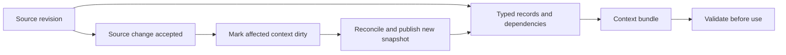

# ASDAI Format

### Precise language. Traceable context. Continuity across AI sessions.

**An open-standard proposal for how humans and AI systems express technical work, preserve evidence, and keep shared context current.**

ASDAI combines a controlled technical language with a persistent context specification. Requirements retain their conditions and exceptions. Derived knowledge points to exact source revisions. When sources change, dependent context becomes ineligible for current use until it is revalidated.

**Working draft `0.1.0` · Draft revision `2026-10-11` · Wire format `asdaif/0.1`**

[**Read the standard →**](ai_language_and_context_standard.md) · [See the worked example](ai_language_and_context_standard.md#s11) · [Validate the examples](#validate-the-examples) · [Contribute](#help-shape-the-standard)

> **Available today:** a self-contained specification, schemas, algorithms, a worked software change, and an executable document validator. A complete context runtime, migration tooling, and comparative benchmark results remain implementation work. This is a proposed standard without institutional adoption.

## Find your starting point

| If you are… | Start here | What you can assess |
| --- | --- | --- |
| An agent or application developer | [Language and examples](ai_language_and_context_standard.md#s4) | How to express requirements, decisions, and uncertainty precisely |
| A memory or tooling implementer | [Record schemas](ai_language_and_context_standard.md#s6) · [Interface contracts](ai_language_and_context_standard.md#s9) | How to exchange records and preserve validity across updates |
| A researcher or evaluator | [Benchmark protocol](ai_language_and_context_standard.md#s13) | How to test fidelity, task success, freshness, latency, and cost |
| A standards contributor | [Evolution contract](ai_language_and_context_standard.md#s12) · [Conformance checklist](ai_language_and_context_standard.md#s14) | How to propose changes and document compatibility |

**On this page:** [Positioning](#where-asdai-fits) · [State](#how-state-evolves) · [Upgrades](#a-standard-that-can-evolve) · [Adoption](#adopt-in-defined-stages) · [Validation](#validate-the-examples) · [Contribution](#help-shape-the-standard)

## Why a shared standard matters

Long-running AI work needs continuity of meaning: which requirement applies, what evidence supports a conclusion, what changed, and what remains unresolved. ASDAI specifies a shared contract for those questions across tools, models, and sessions.

| Contract | What it gives an implementation |
| --- | --- |
| **Precise expression** | Named actors, typed entities, explicit obligations, conditions, exceptions, units, and scope |
| **Traceable memory** | Immutable source revisions, evidence coordinates, declared compression losses, and dependency links |
| **Current context** | Invalidation after source changes, bounded context assembly, and checks immediately before use |
| **Accountable evolution** | Version identity, branch lineage, migration requirements, and evidence-linked improvement proposals |

The specification separates the authoritative catalog from replaceable search indexes. Implementers can choose retrieval engines while preserving the same evidence, permission, and update rules. Interoperability is a design objective to verify through independent implementations.

## Where ASDAI fits

ASDAI targets the meaning and lifecycle of technical context. The following approaches address related layers; the comparison identifies scope rather than claiming performance superiority.

| Standard or approach | Primary focus | ASDAI's relationship |
| --- | --- | --- |
| **[ASD-STE100 Simplified Technical English](https://www.asd-ste100.org/STE_faq.html)** | Controlled technical documentation through writing rules and a dictionary | ASDAI adapts explicit wording and consistent terminology, then adds typed records, evidence semantics, and a persistent context lifecycle. |
| **Agent ADL — [Next Moca's Agent Definition Language](https://github.com/nextmoca/adl)** | Declarative agent definitions: identity, tools, model settings, retrieval inputs, permissions, and dependencies | An agent definition describes its configuration; ASDAI describes the requirements, evidence, and changing context it uses. An integration could connect these layers; no adapter is supplied here. |
| **[Agent Definition Language, `draft-nederveld-adl-02`](https://www.ietf.org/archive/id/draft-nederveld-adl-02.html)** | A separate JSON-based agent description proposal covering capabilities, security, and runtime configuration | Included to distinguish another project using “ADL.” This comparison refers to the named draft, not an adopted IETF standard or every ADL implementation. |
| **Markdown, JSON, and JSON Schema** | Document presentation, data serialization, and structural validation | ASDAI uses these formats and adds requirements for meaning, provenance, authority, and validity over time. |
| **Retrieval-augmented generation (RAG), graph retrieval, and agent memory** | Finding and managing information for model use | ASDAI specifies obligations around retrieved information: preserve critical constraints, expose gaps, track dependencies, and revalidate before action. [Research comparison](ai_language_and_context_standard.md#s2). |

**Naming:** “ASD100” is interpreted here as **ASD-STE100**. ASDAI is an independent proposal inspired by that standard; it does not claim official succession or full ASD-STE100 compliance. “Agent ADL” uses Next Moca's project as the working comparison because the name is ambiguous. External descriptions were reviewed on 2026-10-11.

For performance evaluation, the draft identifies **Contextual AI's March 19, 2024 RAG 2.0 announcement** as its primary “RAG2” reference and treats **NAACL 2025 RAG²** as a separate method. Exact baseline artifacts and comparable resource budgets are required before a superiority claim. [Baseline identities and limits](ai_language_and_context_standard.md#s2).

## How state evolves

ASDAI extends the controlled-document model into explicit, revision-bound state. This is the design progression represented in the current draft, not a claim about earlier ASDAI releases.

| Layer | What becomes explicit | Specification |
| --- | --- | --- |
| **Language** | Who must do what, under which conditions, exceptions, and authority | [§4](ai_language_and_context_standard.md#s4) |
| **Evidence** | Whether a proposition is supported, refuted, unknown, or conflicting | [§5](ai_language_and_context_standard.md#s5) |
| **Memory** | Which source revisions and derivation inputs a representation depends on | [§6](ai_language_and_context_standard.md#s6) |
| **Change** | Which records remain eligible after edits, deletions, concurrent writes, or rollback | [§7](ai_language_and_context_standard.md#s7) |
| **Use** | Whether a context bundle is current, authorized, and sufficient for the intended action | [§8](ai_language_and_context_standard.md#s8) |

The four evidence states are **`TRUE`** (support only), **`FALSE`** (refutation only), **`UNKNOWN`** (neither), and **`CONFLICT`** (both). A failed search cannot turn `UNKNOWN` into `FALSE`. Conflicting evidence remains visible. These evidence states are distinct from operation status, source generations, and specification versions.



**A concrete example:** the draft begins with a GET retry limit of **3 total attempts within 1,000 ms**. The owner later changes it to **2 total attempts within 600 ms**. The POST retry prohibition remains. Acceptance of that change invalidates affected rules, summaries, test evidence, and pending action leases. A later session must use the current requirements; the old snapshot remains available only as authorized history. [Follow the complete example](ai_language_and_context_standard.md#s11).

Compression declares what it preserves, approximates, or omits. Critical constraints remain exact, and implementations reopen original sources when required. External memory expands access to useful information; it does not enlarge a model's native attention window.

## A standard that can evolve

[Section 12](ai_language_and_context_standard.md#s12) makes evolution part of the standard through six normative requirements. These specify implementation and publisher obligations; the repository does not yet supply an upgrade service.

| Requirement | Adoption contract |
| --- | --- |
| **`EVO-01` · Version identity** | Pin immutable release manifests, artifact digests, profiles, and implementation revisions. Negotiate compatible additions; give incompatible meanings a new major version. |
| **`EVO-02` · Future branches** | Identify each branch's owner, base release, changed requirements, compatibility scope, and migration availability. Preserve upstream identity and distinguish experiments. |
| **`EVO-03` · Checked upgrades** | Map old records to new records, declare semantic changes and losses, invalidate dependencies, run applicable checks, and provide recovery before activation. |
| **`EVO-04` · Self-observance** | Record an implementation's own requirement-check outcomes with versions, evidence, failures, and checks not run. Separate observations from improvement suggestions. |
| **`EVO-05` · Discovery** | Let operators inspect releases and proposals from configured publishers, through local or online catalogs. Report freshness and availability; keep adoption separately authorized. |
| **`EVO-06` · Reviewed improvement** | Link proposals to observations, compatibility analysis, migration examples, conformance cases, and an authorized review decision. |

**The adoption loop:** use → observe → propose → review → publish → discover → validate → adopt.

Here, **self-observance** means applying ASDAI's evidence rules to the implementation's own behavior. Active use can reveal ambiguous wording, interoperability failures, or missing checks and turn those findings into reviewable proposals. Observations may remain local; external sharing requires authorization. A self-reported pass is not independent certification.

The upgrade goal is continuity with explicit compatibility checks. A version bump alone cannot prove that a migration preserves meaning. Existing records retain their identities, and the standard prohibits silently reinterpreting history or restoring revoked access during recovery.

## Adopt in defined stages

The profiles let teams build toward interoperability with explicit dependencies and testable claims.

| Profile | Implement | Dependency |
| --- | --- | --- |
| **L · Language** | Parse, type-check, and round-trip controlled statements | Core language and evidence semantics |
| **M · Memory** | Store immutable revisions and representations; process source and access changes | L |
| **C · Context** | Assemble traceable bundles within a budget, with explicit gaps and use-time validation | M |
| **E · Evaluation** | Produce reproducible comparisons with pinned systems and resource budgets | Record the exact profiles tested |

1. **Explore:** read the language examples and run the document validator.
2. **Implement:** choose a profile, include its dependencies, and publish outcomes for applicable requirements.
3. **Interoperate:** exchange records with an independent implementation and compare acceptance and rejection behavior.
4. **Improve:** submit reproducible observations and proposed conformance cases through the evolution process.

Reading the prose or passing the example validator does not establish runtime conformance. The [roadmap](ai_language_and_context_standard.md#s12) defines implementation milestones; the [conformance checklist](ai_language_and_context_standard.md#s14) defines the evidence an implementation must provide.

## Validate the examples

From the repository root, use **Python 3.11 or later**:

```bash
python3 -m venv .venv
source .venv/bin/activate
python3 -m pip install jsonschema==4.26.0
python3 scripts/validate_standard.py
```

The checker covers:

- 11 embedded records, source hashes, evidence spans, inventories, references, and token accounting.
- 17 invalid-input checks and 32 four-state logic cases.
- 10 original-policy tests and 10 revised-policy tests.
- 17 section anchors and the inventory of 65 numbered requirements, including `EVO-01`–`EVO-06`.

These checks validate the document's examples and structure. The requirement inventory check does not execute the evolution contract. Runtime conformance, migration behavior, and comparative performance require their own implementations and evidence.

## Help shape the standard

Useful contributions include language ambiguities with concrete examples, independent parsers, record-exchange fixtures, migration cases, privacy-preserving adoption observations, and reproducible benchmark results—including cases where ASDAI loses.

For a specification change, identify the exact draft or release, affected requirements, evidence, proposed wording, compatibility effects, and positive and negative checks. Preserve both contributions: **controlled language and persistent context**.

The project aims for broad community adoption. The repository does not yet include a license or community governance charter; establishing those terms is remaining publication work. The open-standard goal is an invitation to implementation and review, not a claim of institutional endorsement or established ecosystem adoption.

## Repository map

| File | Purpose |
| --- | --- |
| [ai_language_and_context_standard.md](ai_language_and_context_standard.md) | Normative working draft, schemas, algorithms, evolution contract, and evaluation protocol |
| [scripts/validate_standard.py](scripts/validate_standard.py) | Executable document and example checks |
| [.gitignore](.gitignore) | Exclusions for credentials and local agent state |

[**Continue to the specification →**](ai_language_and_context_standard.md)
