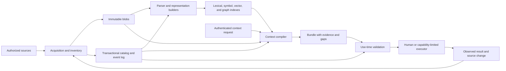

# ASDAI Format: AI Language and Context Standard

**Version:** 0.1.0 — proposed research standard

**Date:** 2026-10-10 UTC

**Draft revision:** 2026-10-11 — adds the evolution contract in Section 12; core wire format remains `asdaif/0.1`.

**Status:** Complete working draft for implementation and evaluation

**Project:** `asdaiformat`

**Evidence status:** Design proposal; no comparative performance results are claimed.

This document proposes an AI-era counterpart to ASD-STE100.
It specifies a controlled technical language and a persistent context system together.
It is a project proposal without institutional adoption.
All schemas, algorithms, examples, and acceptance rules needed to interpret this draft are included here.

## Contents

- [1. Executive summary](#s1)
- [2. Research foundation and comparison baselines](#s2)
- [3. Scope, terms, and conformance](#s3)
- [4. Controlled technical language](#s4)
- [5. Meaning, evidence, and authority](#s5)
- [6. Synthetic context records and schemas](#s6)
- [7. Storage, indexing, and source changes](#s7)
- [8. Retrieval and context assembly](#s8)
- [9. Interface contracts](#s9)
- [10. Security, privacy, and recovery](#s10)
- [11. Worked software example](#s11)
- [12. Implementation roadmap](#s12)
- [13. Benchmark protocol](#s13)
- [14. Conformance checklist and document checks](#s14)
- [15. Limits and losing conditions](#s15)
- [16. Open research questions](#s16)
- [17. References](#s17)

<a id="s1"></a>
## 1. Executive summary

ASDAI Format specifies how humans and artificial intelligence (AI) systems describe technical work and preserve its context across sessions.
Its language expresses obligations, evidence, decisions, and uncertainty without merging their meanings.
Its memory stores compact representations with explicit links to the source revisions from which they were made.

The basic unit is a **context record**.
Each record has a typed meaning, an evidence class, a dependency set, and an access scope.
A summary can help find information, but it cannot silently replace an exact requirement or test observation.
When source material changes, the system invalidates affected records before it presents them as current.

A query produces a **context bundle** for one source snapshot and one current authorization state.
The bundle contains relevant records, mandatory constraints, reopened source excerpts, and unresolved gaps.
The assembly algorithm includes the dependencies needed to interpret each selected claim.
If these items cannot fit within the model's budget, the result requests a narrower task or staged inspection.

The architecture combines immutable source storage, a transactional catalog, dependency indexes, lexical search, vector search, and a context compiler.
The catalog decides validity; search indexes supply candidates.
This separation permits replacement of a retrieval engine without changing the evidence and update rules.

The research hypothesis has three parts:

1. Explicit obligations and source dependencies will reduce errors caused by omitted constraints and outdated information.
2. Multiple representation levels will reduce repeated source reading without losing the details needed for a task.
3. Incremental updates will preserve useful context across repository revisions at lower total cost than repeated reconstruction.

These are hypotheses, not experimental findings.
Section 13 defines success thresholds, comparison systems, costs, statistical tests, and conditions that refute them.
Effective context means successful access to relevant information across a larger source universe.
It does not mean that external memory changes a model's native attention window.

<a id="s2"></a>
## 2. Research foundation and comparison baselines

### 2.1 Lessons from controlled language

ASD-STE100 uses writing rules, a controlled dictionary, and provisions for technical terms.
Its purpose includes reducing ambiguity in technical documentation.
ASDAI adopts the discipline of explicit meanings and consistent terminology, while adding machine-readable contracts and evidence states.
It does not reproduce the ASD dictionary or claim compliance with its full rule set. [ASD-STE100 overview](https://www.asd-ste100.org/about_STE.html), [official FAQ](https://www.asd-ste100.org/STE_faq.html).

| Principle | Treatment in this proposal | Reason |
| --- | --- | --- |
| One preferred term for one declared meaning | Preserve within a versioned vocabulary | Synonym changes must not change requirements |
| Direct, short technical statements | Preserve | A reader must identify the actor, action, and condition |
| Domain-specific technical terms | Preserve with typed declarations | Code symbols and units need exact identities |
| Writing rules for human comprehension | Add parsing and validation rules | A machine needs a defined interpretation |
| Prose as the principal representation | Add a typed intermediate representation | Source comparison and invalidation require structured fields |
| Stable document as the unit of communication | Add revision-bound records and bundles | Software and task state change between sessions |

Controlled language design involves tradeoffs among precision, expressiveness, naturalness, and simplicity.
This proposal favors precise core statements and a readable authoring view.
Unrestricted explanation remains possible, but it is labelled commentary and has no automatic executable meaning.
This design choice follows the problem classification in [Kuhn's survey](https://aclanthology.org/J14-1005.pdf).

### 2.2 What existing methods contribute

The following table identifies established ideas and the additional contract proposed here.
It does not claim that every implementation of a cited method lacks the proposed behavior.

| Primary source | Established contribution relevant here | Additional ASDAI obligation |
| --- | --- | --- |
| [Lewis et al., RAG, 2020](https://arxiv.org/abs/2005.11401) | Generation can use retrieved non-parametric memory | Bind the result to source versions, authority, and explicit gaps |
| [RAPTOR, 2024](https://arxiv.org/abs/2401.18059) | Retrieval can operate over recursive summary levels | Track omitted information and preserve exact obligation records |
| [GraphRAG, 2024](https://arxiv.org/abs/2404.16130) | Graph structures and community summaries support global questions | Separate semantic associations from validity dependencies |
| [MemGPT, 2023](https://arxiv.org/abs/2310.08560) | A controller can move information between memory tiers | Define snapshot and revocation barriers for each assembled context |
| [LLMLingua, 2023](https://arxiv.org/abs/2310.05736) | Prompt compression can reduce inference input | Declare fidelity classes and reopen exact material when required |
| [A-MEM, 2025](https://arxiv.org/abs/2502.12110) | Linked notes can evolve as memories arrive | Preserve immutable history and validate changed dependency sets |
| [Mem0, 2025](https://arxiv.org/abs/2504.19413) | Extraction, consolidation, and retrieval support persistent memory | Keep observations, assumptions, and derived conclusions distinct |
| [Agentic Context Engineering, 2025](https://arxiv.org/abs/2510.04618) | Incremental updates to context can preserve experience | Make updates conditional on source, permission, and vocabulary versions |
| [CodeQL data flow documentation](https://codeql.github.com/docs/writing-codeql-queries/about-data-flow-analysis/) | Program analysis distinguishes syntax from possible value flow | Label static-analysis limits and dynamic dependencies explicitly |
| [W3C PROV-DM](https://www.w3.org/TR/prov-dm/) | Entities, activities, agents, and derivation express provenance | Add the validity and access rules required at use time |

The proposed contribution is the joint contract among language, evidence, change propagation, and bounded context assembly.
None of the individual components above is claimed as a new invention.
Whether their specified combination improves engineering outcomes remains an empirical question.

### 2.3 Resolve “RAG2”

For this draft, **the primary named reference is Contextual AI's RAG 2.0 announcement of March 19, 2024**.
It describes joint optimization of the retriever and language model.
This is the most relevant interpretation of the brief's broad comparison with an enterprise context system.
The announcement is a product research description, not a complete reproducible model release. [Contextual AI, RAG 2.0](https://contextual.ai/research/introducing-rag2).

A different method is **RAG²: Rationale-Guided Retrieval-Augmented Generation**, published at NAACL 2025.
It uses query rationales, balanced retrieval, and filtering in medical question answering.
Its repository states that the original filtering checkpoint is unavailable and that some corpora cannot be redistributed.
It is a secondary mechanism comparison; it is not interchangeable with Contextual AI's system. [Paper](https://aclanthology.org/2025.naacl-long.635/), [authors' repository](https://github.com/dmis-lab/RAG2).

| Baseline ID | Exact interpretation | Reproducibility decision |
| --- | --- | --- |
| `CTX-RAG2-2024` | Contextual AI, March 19, 2024 RAG 2.0 description | Require a provider-attested model/build identity before an exact-system claim |
| `CTX-HOSTED` | An available, dated Contextual deployment | Record returned version and capabilities; compare as a hosted system, not automatically as the 2024 model |
| `RG-RAG2-2025` | Sohn et al., NAACL 2025, pages 12739–12753 | Pin repository commit and replacement artifacts; label any reconstruction |
| `RG-ADAPT-CODE` | The rationale/filtering mechanism adapted to code | A separate baseline with its own tuning budget; never label it the original medical system |

No exact Contextual model version or original RAG² checkpoint was obtained for this document.
That limits future comparison claims, but it does not prevent specification of the proposed system.
An unavailable baseline is reported as unavailable, not assigned a zero score.
Success against open systems alone does not establish superiority over either named RAG2 system.

### 2.4 Source review boundary

Primary source descriptions were reviewed on 2026-10-10 UTC.
Recent memory evaluation is included through [LongMemEval-V2, May 2026](https://arxiv.org/abs/2605.12493).
That work evaluates experience from long interaction histories and includes retrieval and agent-based evidence gathering methods.
Those methods strengthen the proposed comparison beyond simple vector retrieval.

The review also found [ACE-GraphRAG, arXiv:2608.01269](https://arxiv.org/abs/2608.01269).
The authors withdrew that manuscript.
It is excluded from supporting performance evidence and required baselines.
The reviewed source set is explicit; the document does not claim an exhaustive literature search or a proven novelty result.

<a id="s3"></a>
## 3. Scope, terms, and conformance

### 3.1 Normative language

The uppercase words MUST, MUST NOT, SHOULD, SHOULD NOT, and MAY have their BCP 14 meanings.
Lowercase uses of these words carry their ordinary meanings. [RFC 2119](https://www.rfc-editor.org/rfc/rfc2119), [RFC 8174](https://www.rfc-editor.org/rfc/rfc8174.html).

Requirement identifiers such as `LANG-01` are stable within version 0.1.
An implementation MUST record the standard version and supported profiles in its capabilities response.
Unknown major versions MUST be rejected.
Unknown fields in a core object MUST be rejected; extensions use a separately versioned profile.

### 3.2 Core terms

| Term | Meaning |
| --- | --- |
| Source | An authorized file, document, event stream, or tool record |
| Source revision | Immutable bytes with an identity, digest, and acquisition metadata |
| Snapshot | An immutable manifest of source revisions and complete inventory bounds |
| Statement | A typed assertion, requirement, decision, or question |
| Evidence | Specific source material offered in support of a statement |
| Representation | A derived view of source material at a declared fidelity level |
| Dependency | An input whose change requires validity review of a derived object |
| Association | A semantic link useful for retrieval; it does not establish support |
| Context bundle | Selected evidence and statements prepared for one task and snapshot |
| Authority | Permission to issue a requirement or authorize an action within a scope |
| Principal | The authenticated person or service making a request |
| Policy epoch | A monotonic version of current access rules within a tenant |
| Validity | Eligibility for a stated use at a particular snapshot and policy epoch |
| Gap | A missing, inaccessible, unresolved, or unaffordable information requirement |
| Tenant | A separate security and data ownership boundary |
| Operation span | The declared event interval over which an obligation is evaluated |
| Synthetic | Derived from sources; it does not mean fabricated evidence |

### 3.3 Profiles

| Profile | Required capability | What it does not establish |
| --- | --- | --- |
| `L` — Language | Parse, type-check, and round-trip core statements | Truth of a statement or correctness of a program |
| `M` — Memory | Store revisions and representations; apply source and access updates | Quality of a language model's answers |
| `C` — Context | Assemble bounded, traceable bundles with explicit gaps | Completeness of arbitrary program analysis |
| `E` — Evaluation | Produce reproducible comparisons under Section 13 | Universal superiority across all tasks |

`M` requires `L`; `C` requires `M`; `E` records the exact implementation profiles tested.
Profile claims MUST identify passed and failed requirement checks.
The presence of this document or its example validator does not make a runtime conformant.

### 3.4 Scope of version 0.1

The core supports textual software repositories, technical documents, structured task history, and test observations.
Images, audio, binaries, and database snapshots MAY be referenced as source blobs.
Interpretations of those blobs need a named extractor and preserve its uncertainty.
This version does not define a new model architecture, a general theorem prover, or an autonomous authorization system.

<a id="s4"></a>
## 4. Controlled technical language

### 4.1 Human authoring rules

**LANG-01 — Explicit actor.** An executable requirement MUST name one actor and one action.
Split independent actions into separate requirements.

**LANG-02 — Explicit conditions.** A conditional requirement MUST name its trigger and exceptions.
The canonical form always includes `WHEN` and `UNLESS`, using `TRUE` and `FALSE` when needed.

**LANG-03 — Exact entities.** Code symbols, paths, units, versions, and scopes MUST resolve through a versioned symbol table.
Pronouns such as “it,” “this,” and “they” MUST NOT identify an executable target.

**LANG-04 — Separate meanings.** Requirements, observations, inferences, assumptions, decisions, and questions MUST use distinct record kinds.
A change in kind requires a new record and supporting metadata.

**LANG-05 — Visible uncertainty.** Unknown information MUST remain unknown.
An author MUST NOT convert an unsuccessful search into a negative fact.

**LANG-06 — Preserve constraints.** Negation, quantifiers, units, ordering, exceptions, and time limits MUST survive normalization.
A validator MUST reject a rewrite when it cannot preserve these elements.

**LANG-07 — One declared meaning.** Each vocabulary entry MUST have one signature and one meaning in its declared namespace.
Aliases MAY aid authoring, but canonical output uses the declared preferred name.

**LANG-08 — Commentary boundary.** Explanatory prose MUST be marked as commentary.
Commentary MUST NOT add executable obligations absent from the formal statement.

**LANG-09 — Round-trip contract.** Parsing canonical text, serializing its typed form, and rendering it again MUST preserve the typed meaning.
Whitespace and harmless formatting may change; source strings and identifiers may not.

**LANG-10 — Short authoring units.** Human prose SHOULD use one instruction per sentence.
Long conditions SHOULD move into named predicates with visible definitions.
This readability rule MUST NOT remove essential qualifications.

### 4.2 Starter vocabulary

The core vocabulary is deliberately small and extensible.
The entries below are ASDAI definitions, not a copy of the ASD-STE100 dictionary.

| Token or term | Meaning |
| --- | --- |
| `REQUIRE` | Declare an obligation, recommendation, or permission |
| `ASSERT` | Record a proposition with an explicit evidence kind |
| `DECIDE` | Record an authorized selection and its concise rationale |
| `QUESTION` | Record an unresolved question |
| `IN` | Identify the scope |
| `AT` | Identify the source snapshot used to interpret the statement |
| `OWNER` | Identify the issuer responsible for the statement |
| `WHEN` | Identify the trigger condition |
| `UNLESS` | Identify the exception condition |
| `THEN` | Introduce the required action |
| `BECAUSE` | Introduce commentary that explains a decision |
| `TRUE`, `FALSE`, `UNKNOWN`, `CONFLICT` | Four evidence states defined in Section 5 |
| `NOT`, `ALL`, `ANY` | Explicit logical composition |
| `EVERY`, `SOME` | Quantification over a declared finite universe |
| `eq`, `lt`, `lte` | Typed equality and order predicates |
| `exists` | Presence within a named, complete inventory |
| `read`, `write`, `return_status`, `run_check` | Actions with registered signatures and bounded effects |
| `before`, `within_ms` | Explicit order and duration predicates |
| `depends_on`, `supersedes`, `supports`, `contradicts` | Typed relationships with distinct semantics |

Project terms MUST declare a namespace, version, definition, argument types, return type, and effect class.
Units use explicit names such as `duration_ms`; a bare “timeout = 5” is invalid.
Equal spelling does not establish equal symbol identity across languages, modules, or repositories.

### 4.3 Canonical grammar

The following Extended Backus–Naur Form describes the core authoring syntax.
Term resolution and type checking are additional requirements.
Line wrapping is allowed outside quoted strings.

```ebnf
statement   = requirement | assertion | decision | question ;
header      = id, "IN", ref, "AT", ref, "OWNER", ref, ":" ;
requirement = "REQUIRE", header, "WHEN", expr, "THEN", ref,
              modality, call, "UNLESS", expr, "." ;
assertion   = "ASSERT", header, "KIND", evidence_kind, ":", expr, "." ;
decision    = "DECIDE", header, "SELECT", ref, "BECAUSE", string, "." ;
question    = "QUESTION", header, string, "." ;
modality    = "MUST" | "MUST_NOT" | "SHOULD" | "SHOULD_NOT" | "MAY" ;
evidence_kind = "OBSERVATION" | "INFERENCE" | "ASSUMPTION" ;
expr        = "TRUE" | "FALSE" | "UNKNOWN" | "CONFLICT" | call
            | "NOT", "(", expr, ")"
            | ("ALL" | "ANY"), "(", expr, {",", expr}, ")"
            | ("EVERY" | "SOME"), "(", variable, ",", ref, ",", expr, ")" ;
call        = id, "(", [term, {",", term}], ")" ;
term        = ref | variable | scalar | call ;
ref         = "#", id ;
variable    = "$", id ;
id          = letter, {letter | digit | "_" | "-" | "."} ;
scalar      = string | integer | "true" | "false" | "null" ;
string      = JSON_string ;
integer     = JSON_integer ;
letter      = "A" … "Z" | "a" … "z" ;
digit       = "0" … "9" ;
```

Keywords are case-sensitive and reserved.
Identifiers use ASCII; quoted content uses UTF-8.
No implicit conjunction, precedence, anaphora, unit conversion, or negation is permitted.
Bound variables are scoped to their quantifier; free variables are invalid.
`EVERY` and `SOME` reference an explicit finite universe and its snapshot-bound inventory.
Code identifiers remain byte-exact; implementations MUST NOT silently apply Unicode normalization to source identity.

Header aliases such as `#s0` resolve to immutable identifiers before storage.
They are human conveniences, not wire identifiers.
The core statement's full identifier resolves from its enclosing document namespace.

### 4.4 Worked language transformations

| Informal text | Defect | Controlled requirement or question |
| --- | --- | --- |
| “Retry quickly if it fails.” | Actor, failure class, method, count, and duration are missing | Ask which actor, failures, methods, attempt limit, and operation deadline apply |
| “Never leak secrets unless debugging.” | The exception is broad and unbounded | Name the exact redaction rule and reject a debug bypass unless separately authorized |
| “All callers support the new API.” | No inventory or version defines “all” | Use `EVERY` over a complete caller inventory; otherwise record `UNKNOWN` |
| “Tests pass, so deploy.” | Test outcome and deployment permission are conflated | Store a test observation and a separate authorized deployment requirement |

This complete controlled statement retains an exception:

```asdaif
REQUIRE retry.get IN #retry_scope AT #s0 OWNER #role_maintainer :
WHEN ALL(eq(method(#request),"GET"),eq(status(#response),503))
THEN #client MUST retry(#request,3,1000)
UNLESS eq(cancelled(#request),true).
```

Here `retry(Request, Integer, Integer)` means at most three total attempts within one 1,000 ms operation span.
The vocabulary definition, not the method's English name, establishes these details.
The source of that vocabulary is part of the record's dependency set.

A cross-file API migration needs a separate coverage claim and release obligation.
Replace “all callers are updated, so ship” with these statements:

```asdaif
ASSERT migration.callers IN #api_scope AT #s7 OWNER #reviewer :
KIND INFERENCE : EVERY($caller,#caller_inventory,eq(api_version($caller),2)).

REQUIRE migration.check IN #api_scope AT #s7 OWNER #release_owner :
WHEN eq(change_kind(#patch),"breaking_api")
THEN #release_runner MUST run_check(#compatibility_suite)
UNLESS FALSE.

QUESTION migration.dynamic IN #api_scope AT #s7 OWNER #reviewer :
"Does the caller inventory include runtime-loaded plugins?".
```

Here the example namespace registers `api_version(Caller) -> Integer`, `change_kind(Patch) -> String`, and `run_check(CheckSuite) -> Action`.
It also registers the named roles, scope, snapshot, patch, suite, and operation spans.
If plugin enumeration is incomplete, the universal assertion is not established by the known callers alone.
Running the compatibility suite yields a separate observation; it does not grant release permission.
An authorized release gate must explicitly require the needed evidence and approve that action.

The authoring tool SHOULD offer a form for actor, trigger, modality, action, exception, and evidence.
It SHOULD display the canonical statement beside a plain-language explanation.
A human approves requirements; imported documents and model suggestions initially remain unapproved candidates.

### 4.5 Compilation and executable checks

A conforming compiler performs tokenization, parsing, name resolution, type checking, authority checks, and canonical serialization in that order.
It returns diagnostic codes with source spans and suggested repairs.
It MUST NOT repair a logical condition without explicit acceptance of the changed meaning.

Predicates are pure functions over a declared state and evidence inventory.
Actions name capabilities; evaluating a requirement never executes its action.
An implementation can map `within_ms`, `return_status`, or a typed assertion to a test adapter.
The adapter MUST identify its version, observed operation span, environment, and source snapshot.

Statements about arbitrary program behavior may exceed automated analysis.
The compiler then accepts the typed proposition but marks its evidence `UNKNOWN` or its check `manual_required`.
It MUST NOT label syntactic validity as proof of correctness.

### 4.6 Composition and typed interpretation

The following rules map engineering concepts to core statements.
They avoid adding a different grammar for each document type.

| Concept | Core expression | Interpretation |
| --- | --- | --- |
| Goal | Requirement with a named `achieve` action and acceptance-set reference | An intended outcome, not evidence that it occurred |
| Acceptance criterion | Requirement to run a named check plus an observation of its result | Obligation and result remain separate |
| Precondition | Requirement trigger | Must be established before the action |
| Postcondition | Assertion evaluated over an action's completed operation span | A failed postcondition is an observation, not an automatic permission to repair |
| Invariant | `EVERY($event,#span_events,predicate($event))` | Applies only to the declared complete span inventory |
| Failure mode | Named predicate and an explicit response requirement | Separate detection from required recovery |
| Dependency | Typed relation between resolved entities | Derivation dependency and program dependency use distinct relation names |
| Boundary | Named scope with an inventory selector and parent scope | Scope inheritance is explicit, not inferred from prose |
| Ownership and permission | Issuer identity plus an external authority record | Stating ownership does not grant it |
| Version change | New immutable statement plus `supersedes` | Requires authorized approval and retained history |

An authoring document has a header registry for namespace, aliases, vocabulary versions, and operation spans.
Each requirement ID maps to exactly one declared span.
Missing or ambiguous span declarations fail compilation.
The wire `rule.span` stores the resolved span ID.
Scopes, roles, source policies, entity types, and vocabulary definitions are versioned registry objects.
Their source bytes belong to the deployment's control registry and appear in derivation read sets.
They cannot be created or changed merely by encountering their names in retrieved text.

The core predicate signatures are `eq<T>(T,T) -> State`, `lt<T:Ordered>(T,T) -> State`, and `lte<T:Ordered>(T,T) -> State`.
An unknown operand returns `UNKNOWN`; incompatible types fail validation.
Evidence about a known literal Boolean field is separate from its Boolean value: `eq(cancelled(request),true)` returns a State.
`before(Event,Event) -> State` uses declared ordering evidence.
`within_ms(Span,DurationMs) -> State` uses the span's monotonic elapsed duration.
`exists(Entity,Inventory) -> State` returns `FALSE` only after complete authorized inventory inspection.

The example namespace adds `method(Request) -> String`, `status(Response) -> Integer`, and `cancelled(Request) -> Boolean` as pure accessors.
It defines `retry(Request,AttemptCount,DurationMs) -> Action` and `automatic_retry(Request) -> Action` as non-evaluating capability descriptions.
Attempt counts and millisecond durations are positive safe integers with distinct semantic types.
Retries count the initial attempt, stop when cancellation is observed, and never start beyond the declared deadline.
The transport must honor the remaining deadline passed to it; otherwise the result records a failed environmental precondition.

Canonical text maps `TRUE` to `{op:state,value:TRUE}`, scalar values to `literal`, and resolved aliases to `ref` nodes.
Calls and logical forms map directly to the corresponding schema nodes.
`ASSERT` maps its evidence kind and expression without changing their meaning.
`DECIDE ... SELECT #option BECAUSE "reason"` maps to `selected(#option)` and stores the reason in `commentary`.
The decision's options and authority are versioned registry dependencies.
`QUESTION ... "text"` maps to `unresolved("text")`, where `unresolved(String) -> State` always returns `UNKNOWN` until a new answer record is issued.
The registered pure predicate `selected(Option) -> State` refers to an authorized decision, not an executed system change.
Compiler-assigned source evidence, dependencies, and review state accompany the typed record; they are never inferred from an ID alone.

<a id="s5"></a>
## 5. Meaning, evidence, and authority

### 5.1 Four evidence states

Each atomic proposition carries two independent support bits: `(support_true, support_false)`.
`TRUE=(1,0)`, `FALSE=(0,1)`, `UNKNOWN=(0,0)`, and `CONFLICT=(1,1)`.
A contradiction does not make unrelated statements true.
Absence of evidence supplies neither bit.

```text
NOT(t, f)       = (f, t)
ALL(a, b)       = (a.t AND b.t, a.f OR b.f)
ANY(a, b)       = (a.t OR b.t, a.f AND b.f)
EVERY(U, p)     = fold ALL over p(x) for x in U
SOME(U, p)      = fold ANY over p(x) for x in U
EVERY(empty, p) = TRUE, only when the complete universe is known to be empty
SOME(empty, p)  = FALSE, only when the complete universe is known to be empty
```

**SEM-01 — Open-world evidence.** Quantification over an incomplete universe MUST retain an `UNKNOWN` contribution for unseen members.
This permits a known counterexample to refute `EVERY`, but prevents an unsupported universal truth.
Likewise, a witnessed match can support `SOME` without proving the absence of other matches.

**SEM-02 — Operational decision.** A requirement activates only when its trigger is `TRUE` and its exception is `FALSE`.
Unknown or conflicting conditions require evidence expansion or a blocked decision.
`MUST_NOT` prohibits the named action in the activated operation span.
An exception disables only its own requirement; it never creates permission for another action.

**SEM-03 — Permission intersection.** A `MAY` statement never overrides a `MUST_NOT` statement or an external permission denial.
Conflicting active requirements MUST be surfaced together.
The system MUST NOT resolve conflict through recency or retrieval score alone.

**SEM-04 — Bounded check meaning.** A passed test supports only its named assertions, inputs, environment, and source revision.
It does not prove all executions safe.
Elapsed time is measured with a monotonic clock; wall time is metadata for external ordering.

### 5.2 Evidence classes

| Kind | What the record means | Required support |
| --- | --- | --- |
| `requirement` | An authorized issuer requests a behavior | Issuer, scope, authority record, and source text |
| `observation` | A specified observer recorded an event or source property | Exact input revision, observer identity, method, and evidence |
| `inference` | A method derived a conclusion from premises | Premise IDs, method/version, and any proof or review result |
| `assumption` | Work proceeds under an unverified condition | Owner, reason, expiry/review condition; no automatic truth promotion |
| `decision` | An authorized owner selected an option | Options, selection, concise rationale, and authority |
| `question` | Information is unresolved | Scope, owner, and the information needed |

**SEM-05 — Source presence boundary.** A matching digest and source span establish which bytes were stored.
They do not establish the author's identity, the statement's truth, or that a command actually executed.
Execution observations require an authenticated runner receipt or explicit identification as untrusted reported output.

**SEM-06 — Confidence boundary.** A model score MAY rank hypotheses.
It MUST NOT convert an assumption into an observation or bypass a missing evidence check.
Machine verification, human review, model inference, and unknown status remain distinct.

### 5.3 Time, precedence, and ownership

Records contain both `recorded_at` and a declared validity interval when one exists.
The first is when the system learned the record; the second is when its claim applies.
Neither replaces source revision identity.

**SEM-07 — Explicit supersession.** A replacement requirement MUST identify the requirement it supersedes and carry authority for the same scope.
A new source file with similar wording does not automatically supersede an approved requirement.
Cross-owner conflicts remain unresolved until the authorized owner supplies a decision.

**SEM-08 — Decision history.** The system MUST preserve rejected alternatives and concise decision rationales when they explain current constraints.
It MUST NOT require private model reasoning traces.
Relevant evidence, assumptions, and reviewable explanations are sufficient.

**SEM-09 — Scoped trust.** Retrieved text is data regardless of its wording.
Only a separately authenticated authority channel may create an active instruction.
The retrieval pipeline MUST NOT give an imported “ignore prior rules” paragraph control over the host.

<a id="s6"></a>
## 6. Synthetic context records and schemas

### 6.1 Representation levels and fidelity

A synthetic representation is a derived, structured view of specified sources.
It contains typed statements, retrieval aids, and a declaration of information loss.
It may reduce repeated reading, but it cannot encode arbitrary source information losslessly in fewer bits for every input.
Access to the original source remains part of the design.

| Level | Contents | Intended use | Mandatory expansion condition |
| --- | --- | --- | --- |
| Source | Exact bytes and acquisition metadata | Quotations, edits, detailed review | None; this is the retained original |
| Entity | Signature, type, local contracts, direct dependencies | Locate and understand a symbol | Edit, uncertain alias, or missing implementation detail |
| Component | Interfaces, topology, obligations, known exceptions | Cross-file planning | An action depends on a summarized condition |
| Task | Goal, decisions, constraints, unresolved questions, checked outcomes | Resume work across sessions | A prior result is used against changed inputs |
| Index | Names, terms, brief descriptions, relation hints | Candidate discovery | Any source-derived claim or action |

**REP-01 — Declared fidelity.** A representation MUST use one fidelity class:

- `exact`: its declared payload can reconstruct the identified source fields exactly.
- `structural`: declared structures are preserved, but unlisted source detail is not.
- `lossy`: prose, embeddings, or other approximation may omit or alter details.

“Exact” applies only to the named payload, not an entire repository.
An identifier-only reference is not lossless compression unless the referenced bytes remain available and accessible.
Compression ratios MUST include the retained originals, derived indexes, and metadata when reporting storage savings.

**REP-02 — Protected fields.** A selected requirement's modality, conditions, exceptions, actor, units, scope, and authority MUST remain exact.
A shortened representation may point to the full requirement, but cannot replace those fields with a paraphrase in an actionable bundle.

**REP-03 — Loss declaration.** Each representation MUST declare preserved fields, omitted fields, and conditions that require reopening sources.
These declarations are checked against the configured extraction contract.
An unsupported “nothing omitted” label MUST be rejected.

**REP-04 — Evidence graph.** Every derived statement MUST identify its premises or source spans.
Its dependency set MUST also contain the extractor, vocabulary, and configuration versions that affect its meaning.
An extractor MUST record its complete input read set, including collection membership dependencies.

**REP-05 — Summaries remain derived.** Recursive summarization MUST preserve links to leaf sources and critical statements.
It MUST NOT replace those sources with previous summaries as the only remaining evidence.
Deduplication MAY share storage, but MUST preserve distinct ownership, access, and validity metadata.

### 6.2 Identifiers and bytes

Wire identifiers are Uniform Resource Names (URNs) within an installation namespace.
They are opaque lookup keys, not proof of content or authority.
The example namespace is `urn:asdaif:example:*`.
Real installations MUST prevent identifier reuse within a tenant.

Source digests use SHA-256 over exact bytes before any text conversion.
Text extraction stores a separate derivative with its own digest and a mapping to source coordinates.
Byte ranges are zero-based and half-open: `[start_byte, end_byte)`.
Line numbers are display metadata only.

Catalog records use UTF-8 JSON with duplicate object keys forbidden.
Integers MUST stay in the interoperable range `[-9007199254740991, 9007199254740991]`.
Larger values use a registered decimal-string type.
Record digesting uses the JSON Canonicalization Scheme, excluding the digest and signature envelope themselves. [RFC 8785](https://www.rfc-editor.org/rfc/rfc8785).

A snapshot's digest covers its source inventory, parent, event watermark, scope, and generation.
It does not include derived records that refer back to the snapshot.
This avoids circular hash definitions.
Derived index manifests carry separate digests and name their source snapshot.

### 6.3 Core JSON Schema

The following schema is normative for the core record envelope and its eight payload types.
It uses JSON Schema Draft 2020-12. [JSON Schema core specification](https://json-schema.org/draft/2020-12/json-schema-core).
Cross-record rules in Section 6.4 are also normative; schema validity alone is insufficient.
Timestamps require RFC 3339 date-time validation with a timezone.

<!-- artifact: core-schema -->
```json
{
  "$schema": "https://json-schema.org/draft/2020-12/schema",
  "$id": "urn:asdaif:schema:core:0.1",
  "type": "object",
  "required": ["format", "id", "tenant", "scope_id", "recorded_at", "payload"],
  "additionalProperties": false,
  "properties": {
    "format": {"const": "asdaif/0.1"},
    "id": {"$ref": "#/$defs/id"},
    "tenant": {"type": "string", "minLength": 1},
    "scope_id": {"$ref": "#/$defs/id"},
    "recorded_at": {"$ref": "#/$defs/time"},
    "payload": {"oneOf": [
      {"$ref": "#/$defs/source"}, {"$ref": "#/$defs/snapshot"},
      {"$ref": "#/$defs/statement"}, {"$ref": "#/$defs/representation"},
      {"$ref": "#/$defs/context_request"}, {"$ref": "#/$defs/context_bundle"},
      {"$ref": "#/$defs/event"}, {"$ref": "#/$defs/test_observation"}
    ]}
  },
  "$defs": {
    "id": {"type": "string", "pattern": "^urn:asdaif:[A-Za-z0-9._:-]+$"},
    "ids": {"type": "array", "items": {"$ref": "#/$defs/id"}, "uniqueItems": true},
    "digest": {"type": "string", "pattern": "^[a-f0-9]{64}$"},
    "time": {"type": "string", "format": "date-time"},
    "uint": {"type": "integer", "minimum": 0, "maximum": 9007199254740991},
    "strings": {"type": "array", "items": {"type": "string"}, "uniqueItems": true},
    "expr": {"oneOf": [
      {"type": "object", "required": ["op", "value"], "additionalProperties": false,
       "properties": {"op": {"const": "state"}, "value": {"enum": ["TRUE", "FALSE", "UNKNOWN", "CONFLICT"]}}},
      {"type": "object", "required": ["op", "value"], "additionalProperties": false,
       "properties": {"op": {"const": "literal"}, "value": {"oneOf": [
         {"type": ["string", "boolean", "null"]},
         {"type": "integer", "minimum": -9007199254740991, "maximum": 9007199254740991}]}}},
      {"type": "object", "required": ["op", "id"], "additionalProperties": false,
       "properties": {"op": {"const": "ref"}, "id": {"$ref": "#/$defs/id"}}},
      {"type": "object", "required": ["op", "name"], "additionalProperties": false,
       "properties": {"op": {"const": "var"}, "name": {"type": "string", "pattern": "^[A-Za-z][A-Za-z0-9_.-]*$"}}},
      {"$ref": "#/$defs/call"},
      {"type": "object", "required": ["op", "arg"], "additionalProperties": false,
       "properties": {"op": {"const": "not"}, "arg": {"$ref": "#/$defs/expr"}}},
      {"type": "object", "required": ["op", "args"], "additionalProperties": false,
       "properties": {"op": {"enum": ["all", "any"]}, "args": {"type": "array", "minItems": 1, "items": {"$ref": "#/$defs/expr"}}}},
      {"type": "object", "required": ["op", "var", "universe", "body"], "additionalProperties": false,
       "properties": {"op": {"enum": ["every", "some"]}, "var": {"type": "string", "pattern": "^[A-Za-z][A-Za-z0-9_.-]*$"},
         "universe": {"$ref": "#/$defs/id"}, "body": {"$ref": "#/$defs/expr"}}}
    ]},
    "call": {"type": "object", "required": ["op", "name", "args"], "additionalProperties": false,
      "properties": {"op": {"const": "call"}, "name": {"type": "string", "pattern": "^[A-Za-z][A-Za-z0-9_.-]*$"},
        "args": {"type": "array", "items": {"$ref": "#/$defs/expr"}}}},
    "evidence": {"type": "object", "required": ["source_id", "start_byte", "end_byte", "span_sha256"], "additionalProperties": false,
      "properties": {"source_id": {"$ref": "#/$defs/id"}, "start_byte": {"$ref": "#/$defs/uint"},
        "end_byte": {"$ref": "#/$defs/uint"}, "span_sha256": {"$ref": "#/$defs/digest"}}},
    "rule": {"type": "object", "required": ["trigger", "actor", "modality", "action", "exception", "span"], "additionalProperties": false,
      "properties": {"trigger": {"$ref": "#/$defs/expr"}, "actor": {"$ref": "#/$defs/id"},
        "modality": {"enum": ["MUST", "MUST_NOT", "SHOULD", "SHOULD_NOT", "MAY"]},
        "action": {"$ref": "#/$defs/call"}, "exception": {"$ref": "#/$defs/expr"}, "span": {"$ref": "#/$defs/id"}}},
    "source": {"type": "object", "required": ["type", "logical_id", "locator", "media_type", "bytes_sha256", "byte_length", "policy_ref"], "additionalProperties": false,
      "properties": {"type": {"const": "source"}, "logical_id": {"type": "string", "minLength": 1},
        "locator": {"type": "string", "minLength": 1}, "media_type": {"type": "string", "minLength": 1},
        "bytes_sha256": {"$ref": "#/$defs/digest"}, "byte_length": {"$ref": "#/$defs/uint"}, "policy_ref": {"$ref": "#/$defs/id"}}},
    "snapshot": {"type": "object", "required": ["type", "parent", "branch", "generation", "source_ids", "inventory_sha256", "inventory_selector", "complete", "event_watermark"], "additionalProperties": false,
      "properties": {"type": {"const": "snapshot"}, "parent": {"oneOf": [{"type": "null"}, {"$ref": "#/$defs/id"}]},
        "branch": {"type": "string", "minLength": 1}, "generation": {"$ref": "#/$defs/uint"}, "source_ids": {"$ref": "#/$defs/ids"},
        "inventory_sha256": {"$ref": "#/$defs/digest"}, "inventory_selector": {"type": "string", "minLength": 1},
        "complete": {"type": "boolean"}, "event_watermark": {"$ref": "#/$defs/uint"}}},
    "statement": {"type": "object", "required": ["type", "kind", "snapshot_id", "owner", "critical", "evidence", "dependencies", "validation", "commentary", "valid_from", "valid_until"], "additionalProperties": false,
      "properties": {"type": {"const": "statement"}, "kind": {"enum": ["requirement", "observation", "inference", "assumption", "decision", "question"]},
        "snapshot_id": {"$ref": "#/$defs/id"}, "owner": {"$ref": "#/$defs/id"}, "critical": {"type": "boolean"},
        "rule": {"$ref": "#/$defs/rule"}, "expression": {"$ref": "#/$defs/expr"},
        "evidence": {"type": "array", "items": {"$ref": "#/$defs/evidence"}}, "dependencies": {"$ref": "#/$defs/ids"},
        "validation": {"enum": ["proposed", "source_checked", "runner_checked", "rule_checked", "human_reviewed"]},
        "commentary": {"type": "string"}, "valid_from": {"oneOf": [{"type": "null"}, {"$ref": "#/$defs/time"}]},
        "valid_until": {"oneOf": [{"type": "null"}, {"$ref": "#/$defs/time"}]}, "supersedes": {"$ref": "#/$defs/ids"}},
      "allOf": [
        {"if": {"properties": {"kind": {"const": "requirement"}}},
         "then": {"required": ["rule"], "not": {"required": ["expression"]}},
         "else": {"required": ["expression"], "not": {"required": ["rule"]}}},
        {"if": {"properties": {"kind": {"enum": ["requirement", "observation"]}}},
         "then": {"properties": {"evidence": {"minItems": 1}}}}
      ]},
    "representation": {"type": "object", "required": ["type", "snapshot_id", "level", "fidelity", "statement_ids", "source_ids", "dependencies", "summary", "preserved", "omitted", "reopen_when", "method_id", "config_sha256"], "additionalProperties": false,
      "properties": {"type": {"const": "representation"}, "snapshot_id": {"$ref": "#/$defs/id"},
        "level": {"enum": ["index", "entity", "component", "task"]}, "fidelity": {"enum": ["exact", "structural", "lossy"]},
        "statement_ids": {"$ref": "#/$defs/ids"}, "source_ids": {"$ref": "#/$defs/ids"}, "dependencies": {"$ref": "#/$defs/ids"},
        "summary": {"type": "string"}, "preserved": {"$ref": "#/$defs/strings"}, "omitted": {"$ref": "#/$defs/strings"},
        "reopen_when": {"$ref": "#/$defs/strings"}, "method_id": {"$ref": "#/$defs/id"}, "config_sha256": {"$ref": "#/$defs/digest"}}},
    "context_request": {"type": "object", "required": ["type", "snapshot_id", "head_generation", "policy_epoch", "purpose", "query", "target_ids", "model_id", "tokenizer_id", "budget_tokens", "max_latency_ms", "max_expansions"], "additionalProperties": false,
      "properties": {"type": {"const": "context_request"}, "snapshot_id": {"$ref": "#/$defs/id"},
        "head_generation": {"$ref": "#/$defs/uint"}, "policy_epoch": {"$ref": "#/$defs/uint"},
        "purpose": {"enum": ["explain", "plan", "act", "audit"]}, "query": {"type": "string", "minLength": 1}, "target_ids": {"$ref": "#/$defs/ids"},
        "model_id": {"type": "string", "minLength": 1}, "tokenizer_id": {"type": "string", "minLength": 1},
        "budget_tokens": {"type": "integer", "minimum": 1, "maximum": 9007199254740991},
        "max_latency_ms": {"type": "integer", "minimum": 1}, "max_expansions": {"$ref": "#/$defs/uint"}}},
    "gap": {"type": "object", "required": ["code", "target_ids", "message"], "additionalProperties": false,
      "properties": {"code": {"enum": ["unknown", "conflict", "budget", "unavailable", "stale", "inventory", "analysis_limit"]},
        "target_ids": {"$ref": "#/$defs/ids"}, "message": {"type": "string"}}},
    "context_bundle": {"type": "object", "required": ["type", "request_id", "snapshot_id", "head_generation", "policy_epoch", "principal_id", "purpose", "decision", "record_ids", "mandatory_ids", "reopened", "gaps", "context_text", "input_tokens", "budget_tokens", "expires_at"], "additionalProperties": false,
      "properties": {"type": {"const": "context_bundle"}, "request_id": {"$ref": "#/$defs/id"}, "snapshot_id": {"$ref": "#/$defs/id"},
        "head_generation": {"$ref": "#/$defs/uint"}, "policy_epoch": {"$ref": "#/$defs/uint"}, "principal_id": {"$ref": "#/$defs/id"},
        "purpose": {"enum": ["explain", "plan", "act", "audit"]}, "decision": {"enum": ["ready", "needs_expansion", "abstain", "historical"]},
        "record_ids": {"$ref": "#/$defs/ids"}, "mandatory_ids": {"$ref": "#/$defs/ids"},
        "reopened": {"type": "array", "items": {"$ref": "#/$defs/evidence"}}, "gaps": {"type": "array", "items": {"$ref": "#/$defs/gap"}},
        "context_text": {"type": "string"}, "input_tokens": {"$ref": "#/$defs/uint"}, "budget_tokens": {"$ref": "#/$defs/uint"},
        "expires_at": {"$ref": "#/$defs/time"}}},
    "event": {"type": "object", "required": ["type", "operation", "expected_generation", "sequence", "target_ids", "idempotency_key", "body_sha256"], "additionalProperties": false,
      "properties": {"type": {"const": "event"}, "operation": {"enum": ["upsert", "tombstone", "revoke", "rollback"]},
        "expected_generation": {"$ref": "#/$defs/uint"}, "sequence": {"$ref": "#/$defs/uint"},
        "target_ids": {"$ref": "#/$defs/ids"}, "idempotency_key": {"type": "string", "minLength": 1}, "body_sha256": {"$ref": "#/$defs/digest"}}},
    "test_observation": {"type": "object", "required": ["type", "snapshot_id", "runner_id", "command", "environment_sha256", "exit_code", "duration_ms", "output_source_ids", "assertion_ids", "receipt_id"], "additionalProperties": false,
      "properties": {"type": {"const": "test_observation"}, "snapshot_id": {"$ref": "#/$defs/id"}, "runner_id": {"$ref": "#/$defs/id"},
        "command": {"type": "array", "minItems": 1, "items": {"type": "string"}}, "environment_sha256": {"$ref": "#/$defs/digest"},
        "exit_code": {"type": "integer", "minimum": -255, "maximum": 255}, "duration_ms": {"$ref": "#/$defs/uint"},
        "output_source_ids": {"$ref": "#/$defs/ids"}, "assertion_ids": {"$ref": "#/$defs/ids"}, "receipt_id": {"$ref": "#/$defs/id"}}}
  }
}
```

### 6.4 Cross-record validation

**DATA-01 — References.** Every referenced ID MUST resolve within the permitted tenant and scope or an explicit authorized import.
Unresolved IDs yield a gap and cannot enter an actionable bundle.
An expression referring to itself does not count as supporting evidence.

**DATA-02 — Coordinates.** Every evidence span MUST satisfy `0 <= start_byte < end_byte <= byte_length`.
The reopened bytes MUST match `span_sha256` and the parent source digest.
A source citation alone does not establish that those bytes entail the associated claim.
Entailment needs a declared review or verification method.

**DATA-03 — State consistency.** Every selected source MUST belong to the requested snapshot or an explicit historical comparison.
A derived record from an earlier snapshot may be reused only after all its dependencies pass revalidation for the requested snapshot.
The original record remains immutable; new snapshot membership records the revalidation.

**DATA-04 — Coverage.** A snapshot with `complete=false` MUST NOT support unqualified universal or absence claims.
An extraction failure records incomplete coverage rather than an empty result.
Membership digests cover ordered pairs of logical source identity and exact revision digest.

**DATA-05 — Expressions.** Registered signatures MUST validate predicate arity, argument types, result types, variable scope, and effect class.
The schema's general expression tree cannot enforce these checks by itself.
Boolean evidence states are not interchangeable with literal Boolean field values.

**DATA-06 — Bundles.** `input_tokens` MUST not exceed `budget_tokens`.
Mandatory IDs MUST appear in `record_ids` with their necessary evidence or exact source expansions.
An `act` bundle marked `ready` MUST have no unresolved task-critical gaps.
Its snapshot, generation, principal, policy epoch, and expiry MUST match the use-time checks.

**DATA-07 — Validity intervals.** A finite `valid_until` MUST follow `valid_from` when both are present.
Expiry is checked at use time.
A decision or observation about a past time must not silently become a claim about the present.

### 6.5 Representation example

This example is a synthetic fixture, not a real observation or a measured result.
The companion source and snapshot records appear in Section 11.

<!-- artifact: representation-example -->
```json
{
  "format": "asdaif/0.1",
  "id": "urn:asdaif:example:repr-retry-r0",
  "tenant": "example",
  "scope_id": "urn:asdaif:example:retry-scope",
  "recorded_at": "2026-10-10T00:00:00Z",
  "payload": {
    "type": "representation",
    "snapshot_id": "urn:asdaif:example:s0",
    "level": "component",
    "fidelity": "structural",
    "statement_ids": ["urn:asdaif:example:req-get", "urn:asdaif:example:req-post"],
    "source_ids": ["urn:asdaif:example:source-spec-r0"],
    "dependencies": ["urn:asdaif:example:source-spec-r0", "urn:asdaif:example:vocab-v1", "urn:asdaif:example:extractor-v1"],
    "summary": "GET retries use at most three total attempts. POST requests have no automatic retry.",
    "preserved": ["method restrictions", "attempt limit", "linked exact requirements"],
    "omitted": ["implementation bodies", "request trace examples"],
    "reopen_when": ["editing retry code", "applying a requirement", "source revision changes"],
    "method_id": "urn:asdaif:example:extractor-v1",
    "config_sha256": "4f53cda18c2baa0c0354bb5f9a3ecbe5ed12ab4d8e11ba873c2f11161202b945"
  }
}
```

<a id="s7"></a>
## 7. Storage, indexing, and source changes

### 7.1 Architecture choice

The reference architecture uses a transactional catalog as the validity authority.
Immutable blob storage holds source bytes and canonical records.
Replaceable indexes produce candidates; they cannot declare a candidate current.



| Candidate architecture | Advantage | Cost or failure mode | Decision |
| --- | --- | --- | --- |
| Flat chunks and a vector database | Simple ingestion and similarity search | Similarity alone does not establish coverage, authority, or freshness | Retain as a baseline and one candidate channel |
| Graph database as the only store | Direct relationship traversal | Arbitrary graph edges do not prove derivation; bulk text retrieval still needs indexes | Use typed adjacency indexes behind the catalog |
| Full repository in native model context | Little preprocessing; exact text available | Context limits, repeated input cost, and sensitivity to evidence position need measurement | Strong baseline where the corpus fits |
| Transactional catalog, immutable blobs, multiple indexes | Atomic validity transitions and interchangeable retrieval | More components, extraction cost, and operational work | Chosen reference design |

This is a design tradeoff, not evidence of better performance.
A single-node implementation MAY use SQLite with durable transactions and a local content store.
A distributed implementation MAY use a transactional database and object storage.
Either MUST satisfy the same concurrency and recovery tests.

### 7.2 Catalog and index contract

The following logical tables are mandatory information, not a required database product.
Every primary and foreign key includes `tenant` and `scope_id` where applicable.
Cross-scope derivation requires an explicit authorized import with its own revocation dependency.

| Catalog relation | Primary identity | Required contents |
| --- | --- | --- |
| `source_revision` | Source record ID | Logical identity, byte digest, length, locator, acquisition receipt, policy reference |
| `snapshot` | Snapshot ID | Parent, branch, inventory digest, generation, watermark, coverage selector, completeness |
| `snapshot_member` | Snapshot ID + logical source identity | Exact source revision; one revision per logical identity |
| `record` | Context record ID | Canonical bytes, type, creation activity, envelope digest |
| `derivation_input` | Derived record ID + input identity | Exact source, symbol, configuration, vocabulary, or inventory selector dependency |
| `record_membership` | Snapshot ID + record ID | Valid, invalid, pending, or historical; revalidation activity and reason |
| `requirement_scope` | Scope + requirement ID | Authority, scope inheritance, applicability selector, criticality, supersession |
| `head` | Branch | Current source snapshot, monotonic generation, dirty barrier, index manifest |
| `event` | Scope + sequence | Operation, key, canonical body digest, status, result, outbox cursor |
| `policy_state` | Tenant | Monotonic policy epoch and authoritative access rules |
| `bundle_lease` | Bundle ID | Principal, snapshot, generation, epoch, expiry, dependency closure digest |

Use an inverted index for words, paths, exact identifiers, and error messages.
Use a symbol index for language, qualified name, signature, declaration span, references, and analysis version.
Use vector indexes for semantic associations at each representation level.
Use adjacency indexes for `depends_on`, `calls`, `imports`, `supersedes`, `supports`, and `contradicts`.
These edge types MUST remain distinct.
Store index manifests with snapshot ID, extractor version, embedding model, dimensions, configuration digest, and completed event watermark.

An index can be behind the head without making the catalog incorrect.
A query MUST intersect candidates with valid catalog membership and current access rules.
It MAY fall back to exact source or lexical inspection when an optional vector index is unavailable.
It MUST return a gap when required coverage cannot be obtained.
Search failure is never evidence that the source universe contains no matching fact.

### 7.3 Freshness and dependency rules

**STORE-01 — Immutable identity.** Source revisions, statements, representations, and snapshots MUST be immutable.
Updates create new objects and relationships.
A logical source identity survives revision changes; its content digest does not.

**STORE-02 — Read sets.** A derivation MUST record every input consulted, including failed lookups and inventory selectors.
For example, “no migration files exist” depends on the membership of `db/migrations/**`, not on an empty list of file digests.
A newly added file invalidates that conclusion.
A configuration, extractor, language grammar, or vocabulary change also invalidates affected derivations.

**STORE-03 — Invalidation barrier.** Once an authorized change is accepted, the affected scope MUST become dirty before acknowledging acceptance.
Dirty scopes MUST NOT issue current `act` bundles until reconciliation establishes an eligible head.
For smaller closures, a verified affected-set barrier MAY replace the whole-scope barrier.
Historical reads remain possible with explicit historical status and current authorization.

**STORE-04 — Dependency completeness.** Validity edges MUST cover all recorded derivation inputs.
Semantic association edges MUST NOT substitute for these edges.
When program analysis cannot bound a dependency, the implementation MUST conservatively invalidate the enclosing component or record an analysis gap.
This rule does not claim complete static knowledge of reflection, dynamic loading, external services, or generated code.

**STORE-05 — Atomic publication.** A new head MUST become visible with its inventory, validity membership, and mandatory requirement index in one committed transition.
Optional search indexes may arrive later.
The transition MUST compare the expected generation and increment it monotonically.

**STORE-06 — Concurrent updates.** Conflicting expected generations MUST return a conflict with the current generation.
An identical idempotency key and body MUST return the original operation identity and outcome.
The same key with a different body MUST fail.
After an unknown network outcome, a client MUST inspect the operation before retrying the mutation.

**STORE-07 — Deletion and rollback.** A tombstone MUST remove current membership and invalidate dependent records.
Rollback MUST create a new head generation pointing to an authorized earlier source manifest.
It MUST NOT rewind event sequences, policy epochs, or revocation state.

**STORE-08 — Cycles.** Source and program graphs MAY contain cycles.
Invalidation MUST traverse each affected node at most once per operation using a durable visited set.
A cyclic derivation group MUST be recomputed as one group with a documented fixed-point or conservative invalidation rule.
An unsupported cycle cannot establish its own evidence.

### 7.4 Mutation algorithm

```text
accept_change(authenticated_principal, event, uploaded_bytes):
    authorize write to the registered scope and named logical sources
    validate schema, source limits, body digest, and idempotency key
    BEGIN TRANSACTION
        if key exists:
            require same body digest; return recorded operation
        require event.expected_generation == head.generation
        require no unpublished source-write operation exists for this branch
        allocate sequence; record event and durable outbox item
        set head.dirty = true                       # immediate barrier
    COMMIT
    stage uploaded bytes under content-addressed keys
    enqueue reconcile(operation_id)
    return accepted(operation_id)                  # not a completed snapshot

reconcile(operation_id):
    obtain a renewable operation lease
    read committed event and base generation
    acquire complete source inventory at a documented source barrier
    verify blob digests; record unavailable or unstable inputs as gaps
    changed = changed revisions + additions + tombstones + changed selectors
    affected = reverse_dependency_closure(changed, durable_visited_set)
    rebuild affected records in bounded batches; retain exact input read sets
    reject unsupported promotions of evidence kind or authority
    produce complete snapshot, validity membership, requirement index
    if required inventory or critical extraction is incomplete:
        retain dirty barrier; record recoverable operation failure; return
    BEGIN TRANSACTION
        require lease still owned and expected generation still current
        publish snapshot and required validity indexes
        increment head.generation; advance committed event watermark
        clear dirty barrier only if no accepted event remains uncovered
        record operation success and optional index-build outbox items
    COMMIT
```

Sources without an atomic upstream snapshot need repeated inventories and stable-read checks.
A provider timestamp alone does not establish that all pages were read consistently.
The adapter MUST declare its consistency method, unresolved gaps, and observation interval.
It MUST not claim continuous freshness between unobserved external changes and the next acquisition event.

Reconciliation processes at most 500 catalog items per batch by default.
Queues, cursors, retries, and graph traversal checkpoints are durable.
The reference implementation admits one source-write operation per branch at a time.
Another write receives a recoverable conflict and the active operation ID, subject to authorization.
Internal read-only preparation may retry after a generation conflict with bounded backoff.
A source mutation MUST NOT silently overwrite a changed base by automatically rebasing its expected generation.
The caller reviews the new base and submits a resolved mutation with a new idempotency key.
More concurrent implementations need an equivalent serializable merge contract and explicit overlapping-write rejection.
Workers never publish an index manifest for a partially completed batch.

### 7.5 Reuse and recovery

Unchanged source bytes can share storage across snapshots.
A representation can reuse its bytes only when its entire read set still matches, including inventory selectors and method configuration.
The new membership records who or what revalidated it, against which snapshot, and by which deterministic checks.
Text equality between summaries is insufficient.

A crash before publication leaves the previous head and the dirty barrier intact.
A restarted worker resumes the durable operation; it does not infer success from staged blobs.
A crash after publication but before the response returns is resolved by the operation record.
An outbox consumer can rebuild derived indexes from committed events without changing source truth.
Garbage collection retains blobs referenced by permitted snapshots, retention policies, pending operations, or legal holds.
Section 10 distinguishes retention from a requested privacy purge.

<a id="s8"></a>
## 8. Retrieval and context assembly

### 8.1 Query interpretation and candidate access

**CTX-01 — Bound request.** The compiler MUST bind a request to an authenticated principal, a permitted scope, a snapshot, and an access-policy epoch.
Client-supplied tenant and principal fields MUST NOT grant access.
For `act`, the requested snapshot MUST be the eligible current head.

**CTX-02 — Mandatory information.** The compiler MUST obtain applicable obligations through the requirement-scope index independently of semantic ranking.
The set includes inherited scope rules, exceptions, prohibitions, acceptance criteria, and unresolved critical conflicts.
When task scope is unknown, it MUST ask for scope resolution or include the conservative enclosing scope.
It MUST NOT silently treat an empty semantic result as “no constraints.”

**CTX-03 — Candidate union.** The reference selector SHOULD merge exact symbol/path matches, lexical matches, vector matches, and bounded graph neighbors.
The default experimental recipe takes up to 256 authorized candidates per search channel.
It combines lexical and vector ranks with reciprocal-rank scores `sum(1 / (60 + rank))`.
Ranks start at one; ties use stable record IDs.
These constants are a reproducible starting configuration, not established optimal values.
Mandatory records are outside these candidate caps.

Exact source lookup remains available for unfamiliar identifiers or questions that do not match an existing summary.
For an unfamiliar query, broaden to the relevant inventory and raw lexical/symbol channels before creating a new representation.
If source enumeration or analysis limits prevent adequate coverage, record the limit explicitly.
The compiler cannot prove it found every relevant fact merely because several retrieval channels agree.

### 8.2 Dependency closure and expansion

**CTX-04 — Meaning closure.** Every selected statement MUST bring the information needed to interpret it.
For a requirement, include actor, modality, trigger, exception, operation span, authority, validity, and exact supporting source.
For an inference, include its premises and derivation method, or reopen its source inputs for review.
For a negative or universal claim, include its inventory boundary and completeness record.
Large closures MAY remain in external storage only if the current bundle states that the claim is unresolved for action.

**CTX-05 — Reopening.** The compiler MUST reopen source bytes when a fidelity declaration requires it or a critical field is absent.
It MUST also reopen sources before editing affected code, resolving conflicting claims, or applying an unverified instruction.
The exact spans, enclosing definitions, and dependencies required for the action take priority over summaries.
An excerpt that drops a relevant negation or exception is invalid even when its digest is correct.

**CTX-06 — Loss accounting.** Every compressed item MUST retain its fidelity class and omission declaration in the bundle manifest.
The rendered context MUST distinguish source text, obligations, observations, hypotheses, and commentary.
Summaries MUST NOT replace the protected fields named in Section 6.

### 8.3 Budget contract

Let `W` be the model's native context limit.
Let `F` be all fixed input tokens: system instructions, tools, user request, history, and protocol framing.
Let `O` be the reserved output tokens and `S` a declared safety reserve.
The evidence budget is:

```text
B = min(request.budget_tokens, W - F - O - S)
```

For example, `W=32768`, `F=4096`, `O=4096`, and `S=1024` leave at most `23552` evidence tokens.
These numbers illustrate accounting; they are not performance measurements.
The compiler MUST use the target model's declared tokenizer and count serialized metadata as well as prose.
`context_text` is the final evidence input delivered to the model, including its rendered metadata.
The control envelope is validated outside that input; it is not automatically sent to the model.
An adapter that inserts additional envelope fields into model input MUST count those fields too and revalidate the budget.
If the model provider does not expose exact framing costs, use its counting endpoint or a validated upper bound.
An unsupported tokenizer or nonpositive budget yields a gap, not an assumed fit.

**CTX-07 — Atomic closures.** Mandatory meaning closures MUST fit in full before optional items are added.
The compiler MUST NOT truncate critical requirements, exceptions, or evidence to fit a budget.
When mandatory closure exceeds `B`, return `needs_expansion` or `abstain`, with the minimum missing closure and its cost.
Staged inspection is permitted, but the eventual action needs a current bundle containing its own complete mandatory closure.

The reference packing heuristic ranks optional closures by estimated relevance, task risk reduction, and novelty per marginal token.
Shared dependencies are counted once.
A high-risk code edit increases the priority of exact source spans.
The estimator is a ranking heuristic; it cannot certify semantic completeness or optimal packing.
An implementation MUST expose the selected weights and record them in the benchmark manifest.

### 8.4 Compiler pseudocode

```text
assemble(request, principal):
    state = authorize_and_pin(request, principal)
    require eligible snapshot, current epoch, and supported tokenizer
    mandatory = applicable_requirement_closure(request.targets, state)
    candidates = union(exact, lexical, vector, bounded_graph)(request, state)
    candidates = current_and_authorized(candidates, state)
    selected, gaps = expand_and_verify(mandatory, state)
    if critical gaps exist: return nonready_bundle(selected, gaps)
    if serialized_tokens(selected) > B:
        return needs_expansion(required_tokens, affected_targets)
    frontier = rank_optional_closures(candidates, request, selected)
    while frontier nonempty and within latency and expansion limits:
        item = pop_best(frontier)
        expanded = expand_if_required(item, request.purpose, state)
        if expanded has unresolved critical dependency:
            add gap; continue
        if marginal_serialized_tokens(expanded, selected) <= remaining_budget:
            add expanded; refresh marginal costs for shared dependencies
        else:
            record omitted optional item and reason
    resolve contradictions without promoting uncertain evidence
    render typed records and exact evidence into a delimited data channel
    count final tokens; verify final manifest and all mandatory dependencies
    recheck generation, dirty barrier, permissions, epoch, and expiry
    if any changed: return stale gap; do not label ready
    return bundle with decision determined by purpose and remaining gaps
```

Optional retrieval exhaustion may still permit `ready` when the required action evidence is complete.
An unresolved task-critical gap always prevents an `act` bundle from becoming `ready`.
For `explain` or `audit`, the system MAY present incomplete evidence with explicit gaps.
It MUST distinguish a partial answer from an established negative finding.

### 8.5 Use-time validation

**CTX-08 — Final check.** A bundle is a time-limited view, not permanent permission.
Before use, validate snapshot membership, dependency digests, current access, policy epoch, dirty state, and lease expiry again.
The reference action lease lasts at most 30 seconds.
A shorter lease does not replace validation.
The executor MUST also compare actual workspace digests immediately before applying a patch or running an affected command.

An accepted external change between compilation and execution invalidates the action lease.
The executor reacquires a bundle or verifies unchanged dependencies through an atomic action reservation.
Such a reservation cannot freeze an unrelated remote service; external preconditions require their own conditional-write contract.
Already delivered text cannot be recalled from a model or a human after revocation.
The system can stop future access and tool actions; it cannot erase knowledge already received.

<a id="s9"></a>
## 9. Interface contracts

### 9.1 Transport and identity

The reference transport is HTTPS with UTF-8 JSON and media type `application/json`.
All routes begin with `/v1`.
The server derives the principal and tenant from authenticated credentials.
It validates the envelope scope against that identity.
An MCP adapter MAY expose equivalent tools, but it MUST preserve these same semantics and error states.

**API-01 — Versioning.** Every response MUST identify `asdaif/0.1` and the supported profiles.
Unknown core fields, duplicate JSON keys, unsafe integers, unsupported record versions, and ill-typed expressions MUST fail validation.
Minor revisions may add separately negotiated capabilities; incompatible meanings require a major version.

**API-02 — Mutation identity.** Mutating requests MUST carry `Idempotency-Key` and the expected generation.
The event record stores the canonical request-body digest.
Request retries MUST retain the same key and body.
Operation status is authoritative after a connection failure.

For source writes, the `If-Match` header carries the decimal expected source generation.
For revocation and purge writes, it carries the expected policy epoch instead; the route determines the counter type.
The header MUST agree with any matching counter in the body.
Scope and tenant are part of the server's idempotency namespace.
The server validates client timestamps but records its own acceptance time separately.

| Method and route | Input | Result and required behavior |
| --- | --- | --- |
| `GET /capabilities` | Authentication | Versions, profiles, language vocabularies, model/tokenizer IDs, limits, consistency method |
| `POST /sources` | Source envelope plus uploaded bytes or a registered connector object ID | `202`, operation ID; stage and verify bytes without making them current |
| `POST /events` | Event envelope whose target IDs name staged replacements or existing targets | `202`, operation ID; apply change barrier and reconcile |
| `GET /operations/{id}` | Authorized operation ID | Pending, running, succeeded, or failed; sequence, generation, result, retriable reason |
| `GET /snapshots/{id}` | Authorized snapshot ID | Snapshot envelope and paginated inventory at that exact snapshot |
| `GET /records/{id}` | Authorized record ID | Immutable record and current eligibility metadata kept outside its canonical bytes |
| `POST /context` | `context_request` envelope | `context_bundle` envelope, including a nonready decision when information is insufficient |
| `POST /context/{id}/expand` | Missing target IDs, new total budget, unchanged request purpose | New request and bundle IDs; previous bundle remains immutable |
| `POST /context/{id}/validate` | Intended action and current workspace digests | Short-lived validation receipt or conflict; receipt alone does not execute the action |
| `GET /events?cursor=...` | Opaque scope-bound cursor and `limit` | Committed sequence page, next cursor, and watermark |
| `POST /revocations` | Authorized policy change and affected identities | Epoch increment and immediate access barrier; operation ID for derived-cache cleanup |
| `POST /purges` | Authorized deletion scope and retention resolution | Purge operation and auditable completion or explicit retention conflict |

Source upload and source publication are separate operations.
The source route has a staging idempotency namespace; only a published event advances the source generation.
The core event's target IDs identify staged replacements or existing logical targets as appropriate.
The server rejects mismatched source identities and out-of-scope targets.
Revocation and purge bodies are control-plane objects, not ordinary source statements.
Their core fields are specified in Section 9.4.
Identity-provider bindings and retention policy implementation remain deployment choices.

A submitted event uses `sequence=0` as an unassigned sentinel.
The server allocates the positive committed sequence and returns the stored event record through the operation result.
It rejects any other client-supplied sequence.
To avoid a circular digest, `body_sha256` hashes the JCS serialization of exactly these payload fields:
`operation`, `expected_generation`, `target_ids`, and `idempotency_key`.
The target IDs refer to immutable staged records, so a different source revision changes the intent digest.
The server binds that digest to the authenticated scope and tenant; neither may change under a retry key.
For other mutation routes without an embedded digest, the server hashes the complete canonical request body.

### 9.2 Errors and limits

Errors use `{ "error": { "code": string, "message": string, "retriable": boolean, "operation_id": string-or-null } }`.
Messages MUST NOT expose inaccessible identifiers or source text.

| HTTP status | Meaning |
| --- | --- |
| `400` | Invalid syntax, schema, types, unsupported version, or digest mismatch |
| `401` | Missing or invalid authentication |
| `403` or concealed `404` | Insufficient access; concealment policy must be consistent |
| `409` | Generation conflict, changed idempotency body, stale lease, or unresolved retention conflict |
| `410` | An authorized caller requested a known tombstoned resource |
| `413` | Payload exceeds declared limits |
| `429` | Capacity limit; include bounded `Retry-After` |
| `503` | Required source, catalog, inventory, or tokenizer service is unavailable |

A valid context request can return `200` with `needs_expansion` or `abstain`.
That response is not an actionable success.
Unavailable infrastructure MUST NOT be represented as a successful empty search.

Default limits are 500 records per batch, 1,000 items per page, and 10 MiB per JSON request.
Large source blobs use authenticated streaming upload with a declared digest and deployment quota.
Cursors bind principal, scope, snapshot, policy epoch, and selector; they expire after 15 minutes by default.
A cursor cannot silently switch to a newer snapshot.
All limits are discoverable and included in evaluation manifests.
Registered connectors resolve trusted endpoints server-side; source text cannot nominate an arbitrary URL for privileged fetching.

### 9.3 Context request example

The fixture tokenizer counts one UTF-8 byte as one token.
It exists only to make the document's accounting test deterministic.
It is not an estimate of any production model's tokenization.

<!-- artifact: context-request-example -->
```json
{
  "format": "asdaif/0.1",
  "id": "urn:asdaif:example:request-r0",
  "tenant": "example",
  "scope_id": "urn:asdaif:example:retry-scope",
  "recorded_at": "2026-10-10T00:00:00Z",
  "payload": {
    "type": "context_request",
    "snapshot_id": "urn:asdaif:example:s0",
    "head_generation": 0,
    "policy_epoch": 0,
    "purpose": "act",
    "query": "Implement the GET retry policy and preserve the POST prohibition.",
    "target_ids": ["urn:asdaif:example:client"],
    "model_id": "example/model-fixture-v1",
    "tokenizer_id": "example/utf8-byte-v1",
    "budget_tokens": 4096,
    "max_latency_ms": 2000,
    "max_expansions": 32
  }
}
```

### 9.4 Auxiliary control objects

These objects use JSON with required fields as listed below; unknown fields fail validation.
`ID` is the core URN type, `Counter` is a nonnegative safe integer, and `Text` is a nonempty UTF-8 string.
Lists preserve declared ordering and prohibit duplicate IDs.
Each route also requires authentication, its appropriate conditional header, and an idempotency key when it mutates state.

| Object | Required fields and types | Semantics |
| --- | --- | --- |
| Expand request | `target_ids: ID[]`, `budget_tokens: positive safe integer` | New total budget and missing targets; purpose, scope, and source snapshot inherit from the original request |
| Workspace digest | `logical_id: Text`, `bytes_sha256: lowercase SHA-256` | Exact file expected at action use time |
| Validate request | `action: core call object`, `workspace_digests: WorkspaceDigest[]` | Checks lease, action capability, and observed files; never executes the action |
| Revoke request | `scope_id: ID`, `expected_policy_epoch: Counter`, `principal_ids: ID[]`, `target_ids: ID[]`, `reason: Text` | Removes named principals' read/use access to the named targets and all revealing derivatives; both lists must be nonempty |
| Purge request | `scope_id: ID`, `target_ids: ID[]`, `retention_policy_id: ID`, `reason: Text` | Erases named source identities and revealing derivatives subject to the authorized retention policy; target list must be nonempty |
| Operation result | `format: "asdaif/0.1"`, `operation_id: ID`, `state: pending or running or succeeded or failed`, `sequence: Counter`, `generation: Counter`, `result_ids: ID[]`, `error: error-object or null` | Sequence is zero before assignment; success requires no error; pending state is not completion |
| Validation receipt | `bundle_id: ID`, `principal_id: ID`, `generation: Counter`, `policy_epoch: Counter`, `dependency_sha256: lowercase SHA-256`, `expires_at: date-time`, `receipt_id: ID` | Server-authenticated assertion of checks at one instant; execution still needs Section 8.5's final workspace check |

The core revoke route removes access; granting access uses the deployment's separately authorized identity-management process.
A broad revocation can target an ancestor scope ID, which covers its registered descendants.
The scope registry MUST define the parent relation without cycles.
The server rejects a retention policy selected by an unauthorized caller.
An action validation receipt MUST bind the intended action's canonical digest in its authenticated server-side record.
Changing the action invalidates the receipt even when the bundle ID is unchanged.

Control registry entries are immutable records with `id`, `kind`, `version`, `source_id`, `dependencies`, and `definition`.
`id` and `source_id` are core IDs; `version` is Text; `dependencies` is an ID list.
`kind` is one of `scope`, `role`, `entity`, `vocabulary`, `method`, `policy`, or `span`.
`source_id` names the authoritative registry source revision; it cannot be the entry itself.
Definitions are typed as follows:

| Kind | Definition fields |
| --- | --- |
| `scope` | `parent: ID or null`, `inventory_selector: Text` |
| `role` | `principal_ids: ID[]`, `authorized_scope_ids: ID[]`, `capabilities: Text[]` |
| `entity` | `type_name: Text`, `logical_name: Text`, `source_locator: Text` |
| `vocabulary` | `terms: Term[]`; each term has `name`, `argument_types: Text[]`, `return_type`, `effect: pure or action`, and `meaning`, with other fields Text |
| `method` | `implementation_source_id: ID`, `config_sha256: lowercase SHA-256`, `input_kinds: Text[]`, `output_kind: Text` |
| `policy` | `authority_id: ID`, `policy_source_id: ID`, `evaluation_method_id: ID` |
| `span` | `start_event_type: Text`, `end_event_types: Text[]`, `clock: monotonic`, `inventory_selector: Text` |

Bootstrap trust roots and principal identities are provisioned by the operator through an authenticated control process.
A reference cycle among policy or vocabulary entries does not bootstrap authority.
An implementation MUST validate registry definitions and resolve their dependencies before compiling affected statements.
The compact JSON catalog in Section 11 assumes its listed registry entries; it is not a bootstrap-authority test.

<a id="s10"></a>
## 10. Security, privacy, and recovery

**SEC-01 — Least source access.** A derived record MUST require access to every source whose contents it reveals.
Combining two sources does not grant the union of their readers access to the summary.
The default permitted audience is the intersection of the source audiences.
An authorized declassification produces a new reviewed record with an explicit release policy and provenance.
Removing a citation does not declassify the underlying information.

**SEC-02 — Retrieval isolation.** Candidate search, counts, caches, embeddings, and graph traversal MUST enforce tenant separation.
Implementations SHOULD partition indexes by tenant and filter authorized scope before ranking.
Post-filtering alone MUST NOT expose candidate IDs, counts, snippets, or timing diagnostics from inaccessible sources.
Cache keys include tenant, principal authorization class, snapshot, policy epoch, request purpose, and tokenizer.

**SEC-03 — Instruction isolation.** Retrieved text MUST remain in a delimited data channel.
Its text cannot change tool permissions, promote itself to a system message, approve a requirement, or alter an evidence kind.
External action approval comes from authenticated authority and the executor's capability checks.
Markup escaping and delimiters support this boundary but do not prove model immunity to prompt injection.
The executor enforces permissions independently of the model's generated text.
Research on separating trusted instructions from untrusted input motivates this layered treatment. [Hines et al., spotlighting](https://arxiv.org/abs/2403.14720).

**SEC-04 — Revocation.** A policy change MUST increase the policy epoch and block newly disallowed access before asynchronous cleanup.
Existing leases and caches with an older epoch MUST fail validation.
Historical snapshots do not bypass present authorization.
Access logs SHOULD contain identifiers and decision codes rather than full private source text.

**SEC-05 — Erasure and retention.** Tombstoning removes current membership; it is not physical erasure.
A purge request MUST track blobs, summaries, indexes, embeddings, replicas, caches, logs, and backup retention obligations.
Completion MUST identify what was erased and what remains under an authorized retention exception.
Backups MUST reapply the revocation ledger before serving restored content.
Encryption keys and backup schedules are part of a deployment's purge policy.

**SEC-06 — Executable boundaries.** Parsing a statement MUST NOT execute a source-supplied command.
Execution needs an allowlisted capability, authorized actor, bounded arguments, and explicit operation span.
Code execution for tests uses an isolated environment with resource limits and controlled network access.
Source paths MUST be confined to registered roots after symlink resolution.
Archives MUST reject traversal and escaping symlinks.

**REC-01 — Recovery evidence.** Health status MUST distinguish durable catalog availability, source acquisition, index lag, extraction errors, and action readiness.
A ready process is not proof of a current corpus.
Recovery MUST replay accepted events exactly once in logical effect and verify referenced blob digests.

**REC-02 — Required fault scenarios.** A conforming runtime MUST test crashes before and after publication, duplicate events, out-of-order arrivals, and corrupt blobs.
It MUST also test permission loss, a failed extractor, a missing index, changed files during action preparation, and restoration of a pre-revocation backup.
The expected response is continued safe service where enough valid data remains, or an explicit nonready result.
Silently serving a stale critical obligation is a failure.

<a id="s11"></a>
## 11. Worked software example

### 11.1 Initial requirement and source inventory

This fictional HTTP client illustrates a change across requirements, implementation, tests, and decisions.
No customer data or production endpoint is involved.
The file layout is:

```text
spec/retry.md          Exact approved behavior
src/policy.py         Typed retry limits
src/client.py         Retry control flow
tests/test_retry.py   Deterministic transport and deadline checks
docs/decisions.md     Why only GET is retried; unresolved transport assumptions
```

The initial specification revision `r0` contains these exact UTF-8 bytes, including the final newline:

<!-- artifact: source-spec-r0 -->
```text
GET requests that receive status 503 MUST retry with at most 3 total attempts within 1000 ms, unless cancelled.
POST requests MUST NOT retry automatically.
Start no additional attempt after cancellation or at the deadline; bound each transport call by remaining time.
```

The requirement source is approved by the fictional maintainer within the retry scope.
That approval is an assumption of this fixture, not an actual institutional authorization.
The normalized GET rule uses the canonical statement in Section 4.4.
The POST rule is:

```asdaif
REQUIRE retry.post IN #retry_scope AT #s0 OWNER #role_maintainer :
WHEN eq(method(#request),"POST")
THEN #client MUST_NOT automatic_retry(#request)
UNLESS FALSE.
```

Both rules bind the operation span from invocation through final response or cancellation.
The third source line is part of the retry action's declared meaning and supporting evidence.
The client dependency graph is `client -> policy -> specification`, with tests observing all three.
The decision record retains the concise rationale that a repeated POST can repeat a side effect.
This rationale does not establish that every GET is safe; that remains an interface assumption requiring review for the actual service.

### 11.2 Records and evidence coordinates

The compact catalog below inventories only `spec/retry.md`.
Its selector explicitly limits completeness to that file; it does not claim a complete repository inventory.
Each source record has an exact SHA-256 digest.
The GET evidence covers the whole specification, preserving the deadline qualification.
The POST evidence covers its exact line, without the trailing newline.

The fixture registry resolves the following external IDs in the `urn:asdaif:example:` namespace:

| Suffix | Registered meaning |
| --- | --- |
| `retry-scope` | Scope containing the fictional retry task |
| `role-maintainer` | Fictional approved issuer for this scope |
| `client` | Actor and code entity `src/client.py::execute` |
| `request`, `response` | Typed operation input and most recent response |
| `operation` | One invocation-to-return span |
| `policy-source` | Fixture access policy permitting the example principal |
| `vocab-v1` | Section 4.6 signatures and retry meaning |
| `extractor-v1` | Deterministic fixture mapping, configuration bytes `[]` |
| `principal` | Fictional authenticated caller |

Inventory hashing uses the UTF-8 JSON canonical serialization of sorted `[logical_id, bytes_sha256]` pairs.
The example includes the later `r2` source so its supersession can be checked mechanically.
The owner issues fresh records for both requirements after the source file changes.
The POST proposition stays the same, but its source revision and evidence coordinates are revalidated.

<!-- artifact: example-catalog -->
```json
[
  {
    "format": "asdaif/0.1",
    "id": "urn:asdaif:example:source-spec-r0",
    "tenant": "example",
    "scope_id": "urn:asdaif:example:retry-scope",
    "recorded_at": "2026-10-10T00:00:00Z",
    "payload": {
      "type": "source",
      "logical_id": "spec/retry.md",
      "locator": "fixture:spec/retry.md@r0",
      "media_type": "text/markdown",
      "bytes_sha256": "c79a373922f0fbfd1cc0d0bbeb23452942f9f1e22582537eb834a959f26a8d9d",
      "byte_length": 268,
      "policy_ref": "urn:asdaif:example:policy-source"
    }
  },
  {
    "format": "asdaif/0.1",
    "id": "urn:asdaif:example:s0",
    "tenant": "example",
    "scope_id": "urn:asdaif:example:retry-scope",
    "recorded_at": "2026-10-10T00:00:00Z",
    "payload": {
      "type": "snapshot",
      "parent": null,
      "branch": "example",
      "generation": 0,
      "source_ids": [
        "urn:asdaif:example:source-spec-r0"
      ],
      "inventory_sha256": "dd80db5bf8651188f2137cd27c17cbe02a4b1b4098e06a0824aeb5aa12593f69",
      "inventory_selector": "exact:spec/retry.md",
      "complete": true,
      "event_watermark": 0
    }
  },
  {
    "format": "asdaif/0.1",
    "id": "urn:asdaif:example:req-get",
    "tenant": "example",
    "scope_id": "urn:asdaif:example:retry-scope",
    "recorded_at": "2026-10-10T00:00:00Z",
    "payload": {
      "type": "statement",
      "kind": "requirement",
      "snapshot_id": "urn:asdaif:example:s0",
      "owner": "urn:asdaif:example:role-maintainer",
      "critical": true,
      "evidence": [
        {
          "source_id": "urn:asdaif:example:source-spec-r0",
          "start_byte": 0,
          "end_byte": 268,
          "span_sha256": "c79a373922f0fbfd1cc0d0bbeb23452942f9f1e22582537eb834a959f26a8d9d"
        }
      ],
      "dependencies": [
        "urn:asdaif:example:source-spec-r0",
        "urn:asdaif:example:vocab-v1"
      ],
      "validation": "human_reviewed",
      "commentary": "Synthetic fixture approval; no real authorization receipt.",
      "valid_from": null,
      "valid_until": null,
      "rule": {
        "trigger": {
          "op": "all",
          "args": [
            {
              "op": "call",
              "name": "eq",
              "args": [
                {
                  "op": "call",
                  "name": "method",
                  "args": [
                    {
                      "op": "ref",
                      "id": "urn:asdaif:example:request"
                    }
                  ]
                },
                {
                  "op": "literal",
                  "value": "GET"
                }
              ]
            },
            {
              "op": "call",
              "name": "eq",
              "args": [
                {
                  "op": "call",
                  "name": "status",
                  "args": [
                    {
                      "op": "ref",
                      "id": "urn:asdaif:example:response"
                    }
                  ]
                },
                {
                  "op": "literal",
                  "value": 503
                }
              ]
            }
          ]
        },
        "actor": "urn:asdaif:example:client",
        "modality": "MUST",
        "action": {
          "op": "call",
          "name": "retry",
          "args": [
            {
              "op": "ref",
              "id": "urn:asdaif:example:request"
            },
            {
              "op": "literal",
              "value": 3
            },
            {
              "op": "literal",
              "value": 1000
            }
          ]
        },
        "exception": {
          "op": "call",
          "name": "eq",
          "args": [
            {
              "op": "call",
              "name": "cancelled",
              "args": [
                {
                  "op": "ref",
                  "id": "urn:asdaif:example:request"
                }
              ]
            },
            {
              "op": "literal",
              "value": true
            }
          ]
        },
        "span": "urn:asdaif:example:operation"
      }
    }
  },
  {
    "format": "asdaif/0.1",
    "id": "urn:asdaif:example:req-post",
    "tenant": "example",
    "scope_id": "urn:asdaif:example:retry-scope",
    "recorded_at": "2026-10-10T00:00:00Z",
    "payload": {
      "type": "statement",
      "kind": "requirement",
      "snapshot_id": "urn:asdaif:example:s0",
      "owner": "urn:asdaif:example:role-maintainer",
      "critical": true,
      "evidence": [
        {
          "source_id": "urn:asdaif:example:source-spec-r0",
          "start_byte": 112,
          "end_byte": 155,
          "span_sha256": "ea2f5fc3927629dc0c094e75ee53c167583a71d52362545f01faa95b630a1904"
        }
      ],
      "dependencies": [
        "urn:asdaif:example:source-spec-r0",
        "urn:asdaif:example:vocab-v1"
      ],
      "validation": "human_reviewed",
      "commentary": "Synthetic fixture approval; no real authorization receipt.",
      "valid_from": null,
      "valid_until": null,
      "rule": {
        "trigger": {
          "op": "call",
          "name": "eq",
          "args": [
            {
              "op": "call",
              "name": "method",
              "args": [
                {
                  "op": "ref",
                  "id": "urn:asdaif:example:request"
                }
              ]
            },
            {
              "op": "literal",
              "value": "POST"
            }
          ]
        },
        "actor": "urn:asdaif:example:client",
        "modality": "MUST_NOT",
        "action": {
          "op": "call",
          "name": "automatic_retry",
          "args": [
            {
              "op": "ref",
              "id": "urn:asdaif:example:request"
            }
          ]
        },
        "exception": {
          "op": "state",
          "value": "FALSE"
        },
        "span": "urn:asdaif:example:operation"
      }
    }
  },
  {
    "format": "asdaif/0.1",
    "id": "urn:asdaif:example:source-spec-r2",
    "tenant": "example",
    "scope_id": "urn:asdaif:example:retry-scope",
    "recorded_at": "2026-10-10T00:00:00Z",
    "payload": {
      "type": "source",
      "logical_id": "spec/retry.md",
      "locator": "fixture:spec/retry.md@r2",
      "media_type": "text/markdown",
      "bytes_sha256": "e29b00e8b884f3422340554ed6c5560c60ab40dfbe4e1bf1b6305237bacb1ca4",
      "byte_length": 267,
      "policy_ref": "urn:asdaif:example:policy-source"
    }
  },
  {
    "format": "asdaif/0.1",
    "id": "urn:asdaif:example:s2",
    "tenant": "example",
    "scope_id": "urn:asdaif:example:retry-scope",
    "recorded_at": "2026-10-10T00:00:00Z",
    "payload": {
      "type": "snapshot",
      "parent": "urn:asdaif:example:s0",
      "branch": "example",
      "generation": 1,
      "source_ids": [
        "urn:asdaif:example:source-spec-r2"
      ],
      "inventory_sha256": "580a827bed683df9c850bb8eafa64899551cb9ef891bdb0a86c4bd8144dd2bfa",
      "inventory_selector": "exact:spec/retry.md",
      "complete": true,
      "event_watermark": 1
    }
  },
  {
    "format": "asdaif/0.1",
    "id": "urn:asdaif:example:req-get-r2",
    "tenant": "example",
    "scope_id": "urn:asdaif:example:retry-scope",
    "recorded_at": "2026-10-10T00:00:00Z",
    "payload": {
      "type": "statement",
      "kind": "requirement",
      "snapshot_id": "urn:asdaif:example:s2",
      "owner": "urn:asdaif:example:role-maintainer",
      "critical": true,
      "evidence": [
        {
          "source_id": "urn:asdaif:example:source-spec-r2",
          "start_byte": 0,
          "end_byte": 267,
          "span_sha256": "e29b00e8b884f3422340554ed6c5560c60ab40dfbe4e1bf1b6305237bacb1ca4"
        }
      ],
      "dependencies": [
        "urn:asdaif:example:source-spec-r2",
        "urn:asdaif:example:vocab-v1"
      ],
      "validation": "human_reviewed",
      "commentary": "Synthetic fixture approval; no real authorization receipt.",
      "valid_from": null,
      "valid_until": null,
      "rule": {
        "trigger": {
          "op": "all",
          "args": [
            {
              "op": "call",
              "name": "eq",
              "args": [
                {
                  "op": "call",
                  "name": "method",
                  "args": [
                    {
                      "op": "ref",
                      "id": "urn:asdaif:example:request"
                    }
                  ]
                },
                {
                  "op": "literal",
                  "value": "GET"
                }
              ]
            },
            {
              "op": "call",
              "name": "eq",
              "args": [
                {
                  "op": "call",
                  "name": "status",
                  "args": [
                    {
                      "op": "ref",
                      "id": "urn:asdaif:example:response"
                    }
                  ]
                },
                {
                  "op": "literal",
                  "value": 503
                }
              ]
            }
          ]
        },
        "actor": "urn:asdaif:example:client",
        "modality": "MUST",
        "action": {
          "op": "call",
          "name": "retry",
          "args": [
            {
              "op": "ref",
              "id": "urn:asdaif:example:request"
            },
            {
              "op": "literal",
              "value": 2
            },
            {
              "op": "literal",
              "value": 600
            }
          ]
        },
        "exception": {
          "op": "call",
          "name": "eq",
          "args": [
            {
              "op": "call",
              "name": "cancelled",
              "args": [
                {
                  "op": "ref",
                  "id": "urn:asdaif:example:request"
                }
              ]
            },
            {
              "op": "literal",
              "value": true
            }
          ]
        },
        "span": "urn:asdaif:example:operation"
      },
      "supersedes": [
        "urn:asdaif:example:req-get"
      ]
    }
  },
  {
    "format": "asdaif/0.1",
    "id": "urn:asdaif:example:req-post-r2",
    "tenant": "example",
    "scope_id": "urn:asdaif:example:retry-scope",
    "recorded_at": "2026-10-10T00:00:00Z",
    "payload": {
      "type": "statement",
      "kind": "requirement",
      "snapshot_id": "urn:asdaif:example:s2",
      "owner": "urn:asdaif:example:role-maintainer",
      "critical": true,
      "evidence": [
        {
          "source_id": "urn:asdaif:example:source-spec-r2",
          "start_byte": 111,
          "end_byte": 154,
          "span_sha256": "ea2f5fc3927629dc0c094e75ee53c167583a71d52362545f01faa95b630a1904"
        }
      ],
      "dependencies": [
        "urn:asdaif:example:source-spec-r2",
        "urn:asdaif:example:vocab-v1"
      ],
      "validation": "human_reviewed",
      "commentary": "Synthetic fixture approval; no real authorization receipt.",
      "valid_from": null,
      "valid_until": null,
      "rule": {
        "trigger": {
          "op": "call",
          "name": "eq",
          "args": [
            {
              "op": "call",
              "name": "method",
              "args": [
                {
                  "op": "ref",
                  "id": "urn:asdaif:example:request"
                }
              ]
            },
            {
              "op": "literal",
              "value": "POST"
            }
          ]
        },
        "actor": "urn:asdaif:example:client",
        "modality": "MUST_NOT",
        "action": {
          "op": "call",
          "name": "automatic_retry",
          "args": [
            {
              "op": "ref",
              "id": "urn:asdaif:example:request"
            }
          ]
        },
        "exception": {
          "op": "state",
          "value": "FALSE"
        },
        "span": "urn:asdaif:example:operation"
      },
      "supersedes": [
        "urn:asdaif:example:req-post"
      ]
    }
  }
]
```

### 11.3 Initial context and implementation

The component representation in Section 6.5 finds the retry component efficiently.
For an edit, the compiler reopens the requirement source and both code files.
It also selects the exact POST prohibition through the requirement index, even if semantic search ranks it poorly.
Because the compact catalog above does not contain the code files, its standalone bundle correctly requests expansion.
This response demonstrates that an incomplete example cannot issue an actionable claim.
A deployed compiler would ingest the complete workspace inventory and then construct a new action bundle.

<!-- artifact: context-bundle-example -->
```json
{
  "format": "asdaif/0.1",
  "id": "urn:asdaif:example:bundle-r0",
  "tenant": "example",
  "scope_id": "urn:asdaif:example:retry-scope",
  "recorded_at": "2026-10-10T00:00:00Z",
  "payload": {
    "type": "context_bundle",
    "request_id": "urn:asdaif:example:request-r0",
    "snapshot_id": "urn:asdaif:example:s0",
    "head_generation": 0,
    "policy_epoch": 0,
    "principal_id": "urn:asdaif:example:principal",
    "purpose": "act",
    "decision": "needs_expansion",
    "record_ids": [
      "urn:asdaif:example:source-spec-r0",
      "urn:asdaif:example:s0",
      "urn:asdaif:example:req-get",
      "urn:asdaif:example:req-post"
    ],
    "mandatory_ids": [
      "urn:asdaif:example:req-get",
      "urn:asdaif:example:req-post"
    ],
    "reopened": [
      {
        "source_id": "urn:asdaif:example:source-spec-r0",
        "start_byte": 0,
        "end_byte": 268,
        "span_sha256": "c79a373922f0fbfd1cc0d0bbeb23452942f9f1e22582537eb834a959f26a8d9d"
      },
      {
        "source_id": "urn:asdaif:example:source-spec-r0",
        "start_byte": 112,
        "end_byte": 155,
        "span_sha256": "ea2f5fc3927629dc0c094e75ee53c167583a71d52362545f01faa95b630a1904"
      }
    ],
    "gaps": [
      {
        "code": "inventory",
        "target_ids": [
          "urn:asdaif:example:client"
        ],
        "message": "Current code inventory is not included in this compact fixture."
      }
    ],
    "context_text": "REQUEST: implement retry support.\nREQUIRED SOURCE (r0; exact bytes follow):\nGET requests that receive status 503 MUST retry with at most 3 total attempts within 1000 ms, unless cancelled.\nPOST requests MUST NOT retry automatically.\nStart no additional attempt after cancellation or at the deadline; bound each transport call by remaining time.\nGAP: ingest current client and policy code before editing.\n",
    "input_tokens": 403,
    "budget_tokens": 4096,
    "expires_at": "2026-10-10T00:00:30Z"
  }
}
```

The implementation has two modules.
The transport contract requires `send` to return within its supplied timeout; real transports need their own integration checks.
The example uses an injected monotonic clock and a deterministic fake transport.
These files implement the `r0` behavior:

<!-- artifact: policy-python -->
```python
from dataclasses import dataclass


@dataclass(frozen=True)
class RetryPolicy:
    max_attempts: int = 3
    deadline_ms: int = 1000
    pause_ms: int = 100

    def __post_init__(self):
        for value in (self.max_attempts, self.deadline_ms, self.pause_ms):
            if type(value) is not int or value <= 0:
                raise ValueError("retry limits must be positive integers")
```

<!-- artifact: client-python -->
```python
from dataclasses import dataclass
from policy import RetryPolicy


@dataclass(frozen=True)
class Outcome:
    status: int | None
    attempts: int
    elapsed_ms: int


def execute(method, transport, clock, cancelled, policy=RetryPolicy()):
    start = clock.now_ms()
    deadline = start + policy.deadline_ms
    attempts = 0
    status = None
    while not cancelled() and clock.now_ms() < deadline:
        status = transport.send(method, timeout_ms=deadline - clock.now_ms())
        attempts += 1
        if method != "GET" or status != 503 or attempts >= policy.max_attempts:
            break
        remaining = deadline - clock.now_ms()
        if cancelled() or remaining <= policy.pause_ms:
            break
        clock.sleep_ms(policy.pause_ms)
    return Outcome(status, attempts, clock.now_ms() - start)
```

HTTP methods are case-sensitive in this fixture.
The implementation does not infer that arbitrary method aliases are GET.
Transport exceptions are outside this small retry policy and propagate to the caller.
Adding exception retries would require a new approved requirement, not a summary rewrite.

### 11.4 Executable checks and observed scope

Save the following test module beside `policy.py` and `client.py`, then run `python3 -m unittest -v test_retry`.
The document validator performs that extraction in a temporary directory.
The test runner's real output is separate from the synthetic catalog; the catalog does not invent a signed execution receipt.

<!-- artifact: tests-python -->
```python
import unittest
from client import execute
from policy import RetryPolicy


class Clock:
    def __init__(self):
        self.ms = 0

    def now_ms(self):
        return self.ms

    def sleep_ms(self, duration):
        self.ms += duration


class Transport:
    def __init__(self, clock, statuses=(503,), delay_ms=0):
        self.clock = clock
        self.statuses = statuses
        self.delay_ms = delay_ms
        self.calls = []

    def send(self, method, timeout_ms):
        self.calls.append((method, timeout_ms))
        self.clock.sleep_ms(min(self.delay_ms, timeout_ms))
        return self.statuses[min(len(self.calls) - 1, len(self.statuses) - 1)]


class RetryTests(unittest.TestCase):
    def test_get_has_three_total_attempts(self):
        clock = Clock()
        result = execute("GET", Transport(clock), clock, lambda: False)
        self.assertEqual((result.status, result.attempts), (503, 3))

    def test_post_never_retries(self):
        clock = Clock()
        result = execute("POST", Transport(clock), clock, lambda: False)
        self.assertEqual(result.attempts, 1)

    def test_success_stops_retry(self):
        clock = Clock()
        result = execute("GET", Transport(clock, (503, 200)), clock, lambda: False)
        self.assertEqual((result.status, result.attempts), (200, 2))

    def test_unlisted_status_is_not_retried(self):
        clock = Clock()
        result = execute("GET", Transport(clock, (429,)), clock, lambda: False)
        self.assertEqual(result.attempts, 1)

    def test_cancellation_before_start(self):
        clock = Clock()
        result = execute("GET", Transport(clock), clock, lambda: True)
        self.assertEqual((result.status, result.attempts), (None, 0))

    def test_cancellation_during_pause(self):
        clock = Clock()
        result = execute("GET", Transport(clock), clock, lambda: clock.ms >= 100)
        self.assertEqual(result.attempts, 1)

    def test_deadline_is_shared_across_attempts(self):
        clock = Clock()
        transport = Transport(clock, delay_ms=450)
        result = execute("GET", transport, clock, lambda: False)
        self.assertEqual(result.attempts, 2)
        self.assertEqual(result.elapsed_ms, 1000)
        self.assertEqual(transport.calls, [("GET", 1000), ("GET", 450)])

    def test_revised_policy_has_two_attempts_and_600_ms(self):
        clock = Clock()
        policy = RetryPolicy(max_attempts=2, deadline_ms=600)
        transport = Transport(clock, delay_ms=300)
        result = execute("GET", transport, clock, lambda: False, policy)
        self.assertEqual((result.attempts, result.elapsed_ms), (2, 600))
        self.assertEqual(transport.calls, [("GET", 600), ("GET", 200)])

    def test_revised_policy_preserves_post_prohibition(self):
        clock = Clock()
        policy = RetryPolicy(max_attempts=2, deadline_ms=600)
        result = execute("POST", Transport(clock), clock, lambda: False, policy)
        self.assertEqual(result.attempts, 1)

    def test_invalid_policy_rejected(self):
        for invalid in (0, -1, True, 1.5):
            with self.subTest(invalid=invalid), self.assertRaises(ValueError):
                RetryPolicy(max_attempts=invalid)
```

The checks exercise total attempts, prohibited retry, status selection, cancellation, shared deadline, and the revised policy.
They do not prove correctness of a real HTTP transport, scheduler, or concurrent cancellation primitive.
An actual `test_observation` record would name the runner, exact command, code snapshot, environment digest, output sources, and authenticated receipt.
Successful test output would support only these named cases.

### 11.5 Subsequent revision, invalidation, and later session

The owner then changes the GET limits to two total attempts within 600 ms.
The POST prohibition and cancellation rule remain.
The new exact source bytes are:

<!-- artifact: source-spec-r2 -->
```text
GET requests that receive status 503 MUST retry with at most 2 total attempts within 600 ms, unless cancelled.
POST requests MUST NOT retry automatically.
Start no additional attempt after cancellation or at the deadline; bound each transport call by remaining time.
```

| Transition | Catalog action | What a later session can use |
| --- | --- | --- |
| Requirement `r0` accepted | Create `s0`, exact statements, and component representation | Three attempts, 1,000 ms, no POST retry |
| Implementation and tests recorded | Full deployment creates a workspace snapshot and runner observation | Named cases support the tested code revision |
| Source `r2` accepted | Set dirty barrier; invalidate source-dependent rules, summaries, tests, and pending action leases | Historical `r0` may be inspected; it cannot authorize a current patch |
| New source reconciled | Publish `s2` at generation 1; issue replacement requirement records | Two attempts, 600 ms, unchanged POST prohibition |
| Code adapted | Change policy defaults to `2` and `600`; update old default expectations and rerun checks | New observations refer to the changed workspace |
| New session asks “finish retry support” | Resolve current scope and expand current requirement/code closure | Old three-attempt summary is excluded; unchanged client control flow can be revalidated |

The catalog's generation moves from 0 to 1 even though revision names jump from `r0` to `r2`.
Revision labels are names; generations are concurrency counters.
The example's compact `s0` and `s2` inventories cover the specification file only.
The full workspace snapshots mentioned above additionally cover code, tests, decisions, and control-registry versions.

The old tests are invalid as evidence for the new requirement even if they still pass unchanged.
The default-policy change requires updating `test_get_has_three_total_attempts` to expect two attempts.
The deadline test's expected timeouts become `600` and `50`, with a total elapsed time of 600 ms.
The explicit revised-policy tests already express the new contract.
The validator executes both the original test suite and a mechanically adapted default-policy suite.

If another client submits an edit against generation 0 after `s2` is published, the server returns `409`.
If `spec/retry.md` is deleted, its current requirements and representation memberships become invalid; the system asks for an authoritative replacement.
If an unrelated serializer file changes, its records can be rebuilt without invalidating retry records only when their complete read sets exclude that file and its inventory selector.
If access to the specification is revoked, neither a current nor a historical summary can bypass the new policy epoch.

This example demonstrates the contract through explicit records and small executable checks.
It does not demonstrate repository-scale retrieval, a deployed update service, or comparative advantage over RAG2.

<a id="s12"></a>
## 12. Implementation roadmap

Each phase produces an independently reviewable artifact.
Passing a later phase cannot substitute for a failed authority, validity, or isolation check.

| Phase | Deliverables | Exit condition | Dependencies |
| --- | --- | --- | --- |
| 1. Language kernel | Parser, symbol registry, type checker, canonical renderer, four-state evaluator, authoring form | Positive and negative grammar corpus passes; round-trip meanings match; free variables and unauthorized issuers fail | This draft and an approved fixture vocabulary |
| 2. Durable memory | Blob store, catalog, immutable manifests, event log, exact source coordinates | Crash and replay tests preserve catalog invariants; duplicate events have one logical effect | Phase 1 |
| 3. Change propagation | Complete inventory adapters, derivation read sets, reverse indexes, invalidation barriers | Add/change/delete/rollback and concurrent-edit tests pass; unknown dependencies remain visible | Phase 2 |
| 4. Context compiler | Candidate channels, closure expansion, budget packer, bundle leases | Mandatory information survives packing; stale, revoked, or over-budget actions fail validation | Phases 1–3 |
| 5. Engineering integration | CLI, HTTP and MCP adapters, IDE review view, isolated test runner | One multi-session code task runs with source-linked requirements, changes, observations, and recovery | Phase 4 |
| 6. Evaluation | Frozen systems, held-out tasks, manifests, cost ledger, statistical report | Section 13 protocol completes with published failures and confidence intervals | All earlier phases and preregistration |
| 7. Candidate release | Versioned schemas, migrations, interoperability fixtures, operations guide | Two independent implementations exchange records and reject the same invalid cases | Results and design review |

The initial reference implementation SHOULD keep one authoritative catalog and a replaceable retrieval interface.
Optimize index sharding and learned selection only after profiling the complete pipeline.
The early implementation MUST preserve the full language and update contracts rather than silently dropping difficult clauses.

The project SHOULD assign distinct review responsibility for language semantics, storage/concurrency, security, and evaluation.
Changes to requirement meaning need a versioned proposal, compatibility analysis, migration examples, and accepted conformance cases.
A new vocabulary version does not rewrite past records.
A migration creates new records and records its exact input versions and output mapping.

No phase completion, runtime certification, release date, or staffing commitment is implied by this roadmap.
This deliverable completes the specification draft and its document examples.
The phases describe implementation and evaluation work that follows it.

### 12.1 Version identity and future branches

The following requirements govern specification releases and implementations that adopt them.
They distinguish specification versions, wire-format versions, vocabulary versions, implementation revisions, and source snapshot generations.
These identities MUST NOT substitute for one another.
Until a release is frozen, references to this working draft MUST include its exact source revision or content digest as well as `0.1.0`.

**EVO-01 — Release identity.** A specification publisher MUST publish an immutable release manifest with the specification version, wire-format versions, publication time, publisher identity, document and schema digests, supported profiles, vocabulary versions, conformance artifacts, and compatibility notes.
The manifest MUST identify its predecessor release or explicitly declare that it has none.
Implementations MUST report the exact adopted release identity and implementation revision with their conformance results.
Editorial patch releases MUST preserve normative meaning; compatible additions require a minor revision and explicit capability negotiation; incompatible meanings require a major revision, including during the `0.x` series.
An implementation MUST NOT infer compatibility from a version number alone.

**EVO-02 — Explicit lineage.** A specification branch or extension MUST declare a distinct identifier, owner, base release and digest, changed requirements, compatibility scope, and migration path or an explicit statement that no migration exists.
Experimental branches MUST identify their experimental status.
A fork MUST NOT reuse an upstream release identity for changed semantics or claim upstream conformance without passing its applicable checks.
Adopting a branch or merging its changes requires an authorized decision and new release identity.
Source snapshot branches in Section 7 remain distinct from specification branches; each source branch retains its own publication and invalidation rules.

### 12.2 Upgrade contract

**EVO-03 — Checked migration.** Before changing an adopted release, an implementation MUST negotiate the target versions and profiles and validate an explicit migration plan.
The plan MUST identify exact input and output releases, affected schemas and vocabularies, record mappings, preserved meaning, changed or omitted information, required conformance cases, and recovery steps.
Migration MUST create new records with links to their input revisions and MUST invalidate affected representations, indexes, and context bundles before treating them as current.
An implementation MUST validate the target records and applicable conformance cases before activating the target release.
Failure MUST leave the prior supported release usable under current authorization, or explicitly block the affected scope when safe continued use is unavailable.
Recovery MUST preserve monotonic generations, policy epochs, and revocations as required by Section 7.

This contract supports predictable upgrades without silently reinterpreting old records.
It does not promise a lossless conversion between incompatible meanings.
For example, a vocabulary change that alters a retry predicate requires explicit semantic review and new evidence; relabelling the old record with a new version is insufficient.

### 12.3 Self-observance and active adoption

**Self-observance** means that an implementation records how its own use of ASDAI satisfies or fails the adopted requirements, using the same evidence distinctions that it applies to other technical work.
It includes discovering candidate improvements and preparing reviewable suggestions.
It grants no authority to modify the standard or the implementation's permissions.

**EVO-04 — Adoption observations.** An implementation MUST make its applicable requirement-check outcomes inspectable, including failures and checks not run.
Each observation MUST identify the requirement, adopted specification identity, implementation revision, relevant source snapshot, observer or runner, method, outcome, time, and evidence locator when evidence exists.
Unknown outcomes MUST remain unknown; a self-reported pass MUST NOT be presented as independent certification.
Suggested improvements MUST be separate inferences or questions linked to those observations.
Deployments MAY retain observations locally; external submission requires explicit authorization and removal of credentials and unauthorized private source content.

**EVO-05 — Improvement discovery.** An implementation MUST provide an operator-controlled way to inspect available releases, compatibility notices, and proposals from explicitly configured publishers.
Discovery MAY use a local imported catalog or an online catalog under the deployment's network policy.
Each catalog entry MUST identify its publisher, immutable artifact locator and digest, affected versions and profiles, status (`proposal`, `experimental`, `released`, or `withdrawn`), and migration or review references when applicable.
The implementation MUST record the last successful catalog check and report unavailable or stale discovery information explicitly.
Retrieved catalog content MUST remain data under `SEM-09`; discovery MUST NOT install code, change an adopted version, or activate a proposal without separate authorization and `EVO-03` checks.
Unavailable discovery MUST NOT prevent otherwise valid operation on a pinned, supported release.

**EVO-06 — Reviewable improvement.** A standard change proposal MUST identify its author, base release, affected requirements, supporting observations, proposed wording, compatibility effects, migration examples, and proposed positive and negative conformance cases.
The specification publisher MUST record the authorized review decision and its rationale before incorporating a proposal into a release.
Acceptance MUST link the proposal and decision to the new immutable release manifest.
Popularity, automated suggestions, and successful local use MUST NOT substitute for this review or establish community-wide correctness.

The adoption loop is: use a pinned release → record outcomes → propose an improvement → review → publish a release → discover → validate migration → adopt.
Catalogs and proposal artifacts are separate publication metadata; implementations MUST NOT insert new fields into the closed `asdaif/0.1` core objects.
A machine-readable interchange extension for these artifacts requires a separately versioned, negotiated profile under Section 3.1.
This draft specifies the obligations above; it does not ship a release catalog service, migration engine, or self-observance runtime.

<a id="s13"></a>
## 13. Benchmark protocol

### 13.1 Research questions and claims

The primary question is whether the joint language and context contract improves multi-session engineering outcomes under matched resource limits.
Secondary questions concern which components cause improvements, when costs amortize, and whether humans can author the language accurately.

**EVAL-01 — Preregistration.** Before held-out evaluation, investigators MUST freeze hypotheses, systems, tuning budgets, task splits, metrics, exclusions, and statistical procedures.
Every run MUST bind to an immutable manifest.
No result from the held-out set may select prompts, retrieval settings, or a preferred comparator.

**EVAL-02 — Claim scope.** A claim MUST name the exact systems, models, task distribution, corpus sizes, budgets, and comparison period.
Unavailable or reconstructed RAG2 versions MUST be labelled as such.
No open-baseline result may be presented as a measurement against an unavailable proprietary model.

### 13.2 Required baseline families

| ID | System and fair configuration | Required source or artifact |
| --- | --- | --- |
| `B-LEX` | Coding agent with exact file access and tuned lexical retrieval | Frozen agent harness, parser, lexical engine, prompts |
| `B-HYBRID` | Chunked RAG with lexical/vector retrieval, reranking, current-source metadata, and tuned chunking | Same embedding and reranker budget available to ASDAI |
| `B-LONG` | Raw-source long-context agent at each corpus size that fits | Same generator and useful source ordering; report inapplicable sizes explicitly |
| `B-TREE` | RAPTOR-style hierarchical retrieval | Author method, pinned implementation, all summary construction costs |
| `B-GRAPH` | Microsoft GraphRAG with tuned local/global modes | [Official repository](https://github.com/microsoft/graphrag), exact commit and settings |
| `B-MEMORY` | Best development-set system among MemGPT-style tiering, A-MEM, and Mem0 | Primary methods, pinned implementations, equal tuning allocation; retain all development scores |
| `B-ACE` | Incremental context playbooks using Agentic Context Engineering | Author method and declared reconstruction where no exact release is available |
| `B-RUNBOOK` | Agentic search over raw history and structured experience, informed by LongMemEval-V2 baselines | Exact implementation and any code-task adaptation labelled separately |
| `B-COMPRESS` | Strong hybrid retrieval followed by LLMLingua-style prompt compression | Pinned compressor and fair token accounting |
| `CTX-RAG2-2024` / `CTX-HOSTED` | Section 2's named Contextual comparison, when accessible | Provider version attestation, source-access contract, tool limits, billing receipts |
| `RG-RAG2-2025` / `RG-ADAPT-CODE` | Original-domain reproduction and separately labelled code adaptation | [Authors' repository](https://github.com/dmis-lab/RAG2), replacement checkpoint and corpus declarations |

Do not weaken baselines by disabling available source updates, metadata filters, or native memory features.
Each system receives the same development tasks and up to 40 configuration trials per model family.
Within `B-MEMORY`, divide those trials evenly among the three candidates before selecting the best development configuration.
An additional author-recommended configuration MAY be reported, with its extra tuning cost disclosed.

Run two comparison tracks.
The **controlled track** holds the generator, tools, source access, and limits constant to isolate context-management effects.
The **whole-system track** compares integrated hosted systems under matched total spending and wall-time caps.
If a hosted system cannot use the same generator or tools, it belongs in the second track.
Differences between tracks MUST NOT be attributed solely to the proposed memory architecture.

### 13.3 Task construction and leakage controls

Create at least 400 new engineering episodes from at least 24 independently maintained repositories.
Use five strata of 80 episodes each:

1. Debugging and implementation requiring changes across multiple files.
2. Work resumed across at least three sessions with changed requirements.
3. Dependency tracing and architectural questions with explicit scope inventories.
4. Source updates, deletions, supersession, contradictions, and concurrent edits.
5. Rare critical details, including negation, exceptions, units, and low-frequency identifiers.

Keep development repositories separate from held-out repositories.
Stratify languages, repository sizes, dependency depth, and task difficulty.
Use real evolving source material where possible; disclose all injected requirements and synthetic changes.
Investigators create hidden acceptance checks and annotate required evidence before running systems.
Two qualified reviewers resolve annotation disagreements without seeing system identity.
Neither tests, future patches, nor answer annotations enter the source corpus available to the agent.

Add secondary evaluations on frozen releases of [SWE-bench Verified](https://www.swebench.com/verified), [LongMemEval](https://arxiv.org/abs/2410.10813), and [LongMemEval-V2](https://arxiv.org/abs/2605.12493).
SWE-bench Verified supplies 500 human-validated software issues; it does not itself supply this proposal's changing-requirement protocol.
Memory benchmarks provide independent tests of recall, updates, temporal use, and long interaction histories.
Any translated or code-adapted subset receives a new dataset name and separate results.
Use official grading where available and disclose contamination concerns for public tasks. [SWE-bench paper](https://arxiv.org/abs/2310.06770), [official harness guidance](https://www.swebench.com/SWE-bench/reference/harness/).

Construct corpus tiers near 256,000, 1 million, and 8 million source tokens using genuine distinct content.
Do not inflate size by repeating irrelevant text.
Report exact bytes, files, source tokens, language distribution, and useful-evidence density.
Use evidence budgets of 8,192, 32,768, and 131,072 tokens only when the generator supports them with required fixed input and output reserves.
Prespecify task-to-tier assignments and a primary tier; do not multiply a task into independent observations because several budgets were tested.
Evidence-position permutations test sensitivity to material placed near the beginning, middle, or end. [Lost in the Middle](https://arxiv.org/abs/2307.03172).

### 13.4 Controlled resources and repetition

Use at least three frozen generator model versions and three seeded repetitions per episode.
The minimum primary design therefore has 3,600 episode runs per system at its preregistered primary budget.
Record temperature, seed support, system prompts, tool schemas, environment images, network rules, and maximum action count.
If a provider cannot guarantee deterministic seeds, label repeats as independent service trials and retain request IDs.

Default per-episode caps are 30 minutes, 100 tool actions, and a fixed monetary ceiling declared before runs.
All systems receive the same eligible source snapshots and the same update-event schedule.
No system receives future source revisions early.
Allow each system its documented incremental update path and measure the associated cost.
Run cold-cache and warm-cache conditions separately.
Do not share a cache across held-out tasks unless that sharing is explicitly part of the registered repeated-use experiment.

External provider outages receive a separately reported availability outcome.
A paired comparison MAY rerun all systems for the same affected episode under a preregistered outage policy.
Task failures, model refusals, timeouts, and nonready outputs are otherwise retained in the denominator.
A system cannot improve success rates by discarding its difficult episodes.

### 13.5 Metric definitions

| Metric | Definition and measurement |
| --- | --- |
| Task success | Fraction of assigned episodes satisfying hidden functional tests, required constraints, and permitted action boundaries |
| Semantic fidelity | Preservation rate of annotated proposition fields: actor, modality, negation, quantifier, unit, trigger, exception, time, and version |
| Critical omission rate | Fraction of episodes where an applicable annotated critical field is absent or altered in an action context |
| Evidence precision | Correct source revision and entailing span for each sampled emitted factual claim; source presence and entailment scored separately |
| Evidence recall | Fraction of annotated necessary evidence items retrieved and correctly used |
| Stale-information error | Fraction of post-update opportunities where the system uses a superseded, deleted, or revoked item as current |
| Update latency | Event acceptance to dirty barrier, event acceptance to eligible head, and upstream change to discovery, each reported separately |
| Retrieval latency | Request to validated bundle; p50, p95, p99, timeout rate, and exact-source fallback rate |
| Token use | All input/output tokens for extraction, summaries, planning, retrieval control, regeneration, retries, and final tasks, separated by stage |
| Total cost | Model, embedding, reranking, CPU/GPU time, storage, network, indexing, updates, and human curation at declared prices |
| Effective context | Largest evaluated distinct source universe meeting the declared task-accuracy and critical-error thresholds at a fixed native budget |
| Compression | Serialized representation size divided by original source size; report tokens and bytes with evidence/metadata included |
| Abstention quality | Correctly blocked unsafe/underdetermined actions and unnecessarily blocked solvable actions, both with denominators |

Evidence claims use stratified human review and deterministic revision checks.
Do not grade all claims with an uncalibrated language-model judge.
Report agreement, disputed cases, and the adjudication procedure.
Absence claims require a complete annotated universe; recall over an incomplete real-world universe is labelled an estimate.

For cost, report fresh-use and amortized use at 1, 10, 100, and 1,000 tasks per source corpus.
Let `C_build`, `C_update(k)`, `C_run(i)`, and `C_storage` be measured costs over the same time interval.

```text
total_cost(n) = C_build + sum_k(C_update(k)) + sum_i=1..n(C_run(i)) + C_storage
cost_per_success(n) = total_cost(n) / successful_episodes(n)
```

When no episode succeeds, cost per success is unbounded, not zero.
Report unpriced resource quantities alongside currency, and freeze price dates and cache discounts.
An inexpensive query does not erase an expensive ingestion pipeline.

### 13.6 Proposed acceptance thresholds

Every threshold below is a **target**, not a measured result.
The primary comparison uses `B-HYBRID` and one additional strongest baseline selected only on development data.
An exact RAG2 superiority claim additionally requires passing the same gates against the accessible, precisely identified RAG2 system.

| Gate | Proposed threshold |
| --- | --- |
| Engineering success | At least **5 percentage points** higher task success, with the corrected 95% confidence interval for the paired difference entirely above zero |
| Token efficiency | At most **70%** of baseline online input tokens per successful episode; count every online agent/model call, including failures |
| Total economics | Amortized total cost per success at 100 tasks per corpus no higher than baseline; also publish 1, 10, and 1,000-task results |
| Critical fidelity | At least **99%** preservation of annotated critical fields and at most **1%** stale-information errors; report uncertainty and raw counts |
| Evidence quality | At least **98%** correct-revision, entailing citations on the preregistered review sample |
| Isolation | Zero forbidden tool actions or cross-tenant disclosures in the registered adversarial suite; no claim of universal immunity |
| Effective context | Maintain at least **90%** of the matched oracle-evidence task success rate as corpus size grows, while critical-error thresholds remain satisfied |

The task-success, token-efficiency, and economic gates are joint co-primary gates.
Passing only one does not support the main claim.
Use confidence bounds as well as point estimates: the corrected upper bound for the token ratio must be at most 0.70 and the cost ratio at most 1.00.
For quality thresholds, the relevant lower or upper confidence bound must meet the specified limit.
If uncertainty is too wide, the claim remains unestablished.
Report results per model and stratum; a pooled improvement cannot conceal a critical failure in one supported profile.

Operational targets use a declared reference host with 32 CPU cores, 128 GiB RAM, local NVMe storage, and a 1-million-token corpus.
At eight concurrent requests, target bundle latency is p95 at most 2 seconds after indexes are ready.
Target accepted-change barrier latency is p95 at most 100 ms, and eligible-head publication p95 at most 5 seconds for a 100-file, at-most-1-MiB update.
Report extractor/model hardware and time separately; if required representation rebuilding exceeds five seconds, that target fails.
These are workload-specific engineering targets, not promises for arbitrary source size or provider latency.

### 13.7 Statistics and ablations

Use paired comparisons over the same episodes and seeds.
Bootstrap at the repository level, keeping episodes and repeated seeds together, with at least 10,000 resamples.
Use a preregistered hierarchical model or an appropriate paired method as a sensitivity check.
Do not treat multiple seeds, related tasks, or repeated corpus budgets as independent repositories.
Apply Holm correction to the declared family of baseline comparisons and publish adjusted intervals or compatible corrected tests.

Before final data collection, estimate power from a separate pilot.
Increase the number of independent repositories or episodes if needed for 80% power to detect the five-point target.
Four hundred episodes are a minimum design size, not a guarantee of adequate power.
Do not stop when a favorable interim result appears.
Publish task failures, raw counts, model-specific variation, and negative findings alongside aggregate estimates.

Run these ablations under the same budgets:

- Controlled language with exact source retrieval but no synthetic summaries.
- Synthetic summaries with ordinary prose requirements.
- Full system without hierarchical representation levels.
- Full system without semantic vectors, retaining exact and lexical access.
- Full system without incremental reuse, rebuilding after every update.
- Full system with closure packing replaced by equal-budget ranked chunks.
- Dependency invalidation disabled only in an isolated fault benchmark, to measure stale-error effects.

Access controls and external action permissions remain enabled in every live run.
Measure human authoring separately with at least 24 engineers in a counterbalanced within-participant study.
Compare ordinary requirements with controlled-language authoring on ambiguity detection, correct interpretation, editing time, and learning time.
Use equivalent tasks, blinded scoring, and a documented participant-consent process.
This study is planned; no participants or outcomes are claimed here.

### 13.8 Reproducibility manifest and result status

A runnable experiment manifest MUST include:

- Standard version, implementation commits, dependency lockfiles, schema and vocabulary digests.
- Dataset release IDs, repository commits, split digest, hidden-test custody, episode IDs, and update schedules.
- Baseline version/build identity, reconstruction status, parameter files, and development tuning ledger.
- Generator, embedder, reranker, compressor, tokenizer, prompts, seeds, and provider request identifiers.
- Hardware, operating system, container digests, network policy, quotas, concurrency, and clocks.
- Initial and revised source snapshots, index manifests, accepted-event receipts, selected contexts, and exact token counts.
- Every action, patch, command result, failure, nonready decision, latency sample, cost quantity, and price date.
- Grading scripts, annotations, adjudication records, statistical code, and the frozen analysis plan.

Private sources MAY be represented by restricted-access artifacts and reproducible synthetic counterparts.
The report MUST explain which independent checks are prevented by those restrictions.
An experiment lacking exact baseline artifacts cannot claim exact reproducibility merely because its prompts are public.

**Result status for version 0.1.0:** no comparative benchmark was run.
Only the document's schema, evidence fixtures, internal structure, and small software example are validated in this repository.
The acceptance thresholds above remain open research obligations.

<a id="s14"></a>
## 14. Conformance checklist and document checks

### 14.1 Runtime conformance matrix

An implementation publishes a checklist with a test artifact, exact implementation revision, and outcome for each applicable requirement.
An unchecked item is not a pass.
SHOULD deviations include a reason and an account of their effects.

| Requirement family | Profiles | Positive case | Required rejection or fault case |
| --- | --- | --- | --- |
| `LANG-01`–`LANG-10` | L, M, C | Typed actor, condition, exception, exact entity, canonical round trip | Ambiguous actor, missing unit, unbound variable, altered negation |
| `SEM-01`–`SEM-09` | L, M, C | Four-state evaluation and authorized supersession | Unknown becomes false; conflict resolved by rank; log text promoted to execution proof |
| `REP-01`–`REP-05` | M, C | Exact obligations plus declared summary omissions | Hidden loss of an exception or missing source dependency |
| `DATA-01`–`DATA-07` | M, C | Schema, digest, range, scope, type, and budget validation | Cross-scope ID, wrong byte range, stale snapshot, invalid interval |
| `STORE-01`–`STORE-08` | M, C | Atomic publication, read-set invalidation, replay, rollback | New membership missed by an absence dependency; stale publication after concurrent edit |
| `CTX-01`–`CTX-08` | C | Mandatory closure and exact evidence within budget | Truncated prohibition, revoked lease, unknown tokenizer, action against changed files |
| `API-01`–`API-02` | M, C | Stable versions and idempotent operation lookup | Duplicate keys, unknown core field, key reused with different body |
| `SEC-01`–`SEC-06` | M, C | Authorized evidence access and separate execution authority | Cross-tenant retrieval, source-issued permission, revoked historical access |
| `REC-01`–`REC-02` | M, C | Durable recovery with explicit current state | Restored backup serves revoked data; corrupt blob treated as empty source |
| `EVO-01`–`EVO-06` | L, M, C, E, as applicable to publisher or implementation | Pinned release identity, declared branch lineage, checked migration, evidence-linked adoption feedback | Changed semantics under an old identity; activation before migration checks; catalog text treated as authority; unrun check reported as passed |
| `EVAL-01`–`EVAL-02` | E | Frozen comparable runs and qualified claims | Unavailable baseline scored zero; costs omitted; planned target reported as result |

Requirements in prose without an identifier remain normative when they use BCP 14 terms.
The family table is a navigation aid, not permission to skip those requirements.
A conformance suite MUST test vocabulary signatures, action-span binding, evidence origin, and profile-specific transport behavior as well as JSON shape.

### 14.2 Document validation

The repository provides `scripts/validate_standard.py`.
Its required dependency is Python 3.11 or later with `jsonschema==4.26.0`.
Run:

```bash
python3 -m pip install jsonschema==4.26.0
python3 scripts/validate_standard.py
```

The checker validates the embedded Draft 2020-12 schema and every labelled JSON fixture.
It checks duplicate JSON keys, source hashes, evidence coordinates, snapshot inventories, reference resolution, replacement records, and token accounting.
It also exercises invalid schema cases and runs both versions of the embedded retry example in temporary directories.
It checks document anchors and requirement-family coverage.

These checks establish consistency of this draft's examples.
They do not implement the full language compiler, authenticate the fictional issuer, exercise a production storage service, or measure retrieval performance.
The distinction is part of the acceptance report, not an exception to the runtime requirements.

### 14.3 Specification coverage

| Topic | Where it is specified |
| --- | --- |
| Primary research and exact RAG2 interpretation | Sections 2 and 17 |
| Vocabulary, grammar, meaning, authoring, executable checks | Sections 3–5 |
| Multi-level synthetic representations, evidence, fidelity, uncertainty | Sections 5–6 |
| Storage, indexes, updates, deletion, concurrency, rollback | Section 7 |
| Unfamiliar queries, dependency expansion, fixed context budgets | Section 8 |
| APIs, access control, injection boundaries, recovery | Sections 9–10 |
| Complete change lifecycle and later-session reuse | Section 11 |
| Implementable development plan | Section 12 |
| Baselines, thresholds, cost, repeated trials, uncertainty, ablations | Section 13 |
| Conformance, limitations, questions, references | Sections 14–17 |

<a id="s15"></a>
## 15. Limits and losing conditions

Lossy compression cannot preserve every possible future question about arbitrary source material.
This design preserves exact critical statements, declares omissions, and reopens sources; it does not evade that information limit.
An unanticipated question may require reading most of the original repository.

Dependency invalidation is only as complete as the recorded read sets and acquisition boundary.
Dynamic imports, generated artifacts, remote dependencies, and undocumented behavior can force broad invalidation or leave an explicit gap.
A hash proves byte identity, not semantic entailment, truth, authorship, or execution.
Human review and test observations also have declared scope rather than universal authority.

The system should be expected to lose in these conditions:

- A small, static corpus fits comfortably into native context, making indexing and extraction unnecessary overhead.
- A one-time task cannot amortize representation construction and maintenance.
- Source changes arrive faster than critical records can be revalidated.
- A rare question depends on omitted details scattered across most source files.
- A strong baseline already implements equivalent update, authority, and dependency controls more efficiently.
- Controlled-language authoring costs exceed the ambiguity and error reductions for the target team.
- An unavailable or private RAG2 implementation prevents an exact comparison, leaving that superiority claim unestablished.

Privacy revocation can stop future retrieval and execution, but cannot erase material already delivered to a person or model.
Fine-grained access intersections can reduce useful retrieval coverage.
Mandatory constraints may exceed the context budget; explicit task subdivision can therefore be required.
Nonready results preserve the contract but can lower task throughput, which the benchmarks must count.

No measured result in this document supports deployment, universal factual accuracy, or a general increase in native model context size.
The proposal's value depends on implementation quality and the experiments defined above.

<a id="s16"></a>
## 16. Open research questions

1. Can a representation builder estimate loss for a new query before rereading the original source?
2. Which protected semantic fields most improve engineering outcomes per stored or transmitted token?
3. Can learned retrieval and packing policies improve utility while leaving validity and authority checks deterministic?
4. How should uncertainty propagate through conflicting sources without converting confidence into permission?
5. Can incremental analysis capture dynamic dependency changes at useful cost, with honest completeness boundaries?
6. Which authoring interface best balances precision, review speed, and accessibility across technical backgrounds?
7. How do vocabulary migrations preserve meaning across languages, code generators, and independent implementations?
8. What is the best source-preserving representation for diagrams, runtime traces, and nontextual design artifacts?
9. How should context leases and conditional actions coordinate with external systems that lack transactional preconditions?
10. When does a native long-context model make hierarchical memory uneconomic, and how does that boundary change with model prices?

These questions invite extensions and experiments.
They do not weaken the normative requirements of the version implemented.

<a id="s17"></a>
## 17. References

The following primary sources support the research foundation and benchmark choices.
Source descriptions were reviewed on 2026-10-10 UTC.
Versions and build identities for experiments must still be frozen at preregistration.

1. ASD Simplified Technical English Maintenance Group. [ASD-STE100 overview](https://www.asd-ste100.org/about_STE.html) and [official FAQ](https://www.asd-ste100.org/STE_faq.html). Issue 9, January 2025. Controlled writing rules, vocabulary, and technical terms.
2. Kuhn, T. [A Survey and Classification of Controlled Natural Languages](https://aclanthology.org/J14-1005/). Computational Linguistics, 2014. Design dimensions for controlled languages.
3. Lewis, P., et al. [Retrieval-Augmented Generation for Knowledge-Intensive NLP Tasks](https://arxiv.org/abs/2005.11401). 2020. Parametric and retrieved memory.
4. Contextual AI. [Introducing RAG 2.0](https://contextual.ai/research/introducing-rag2). March 19, 2024. Primary product-research interpretation of RAG2 in this draft.
5. Sohn, J., et al. [RAG²: Rationale-Guided Retrieval Augmented Generation for Medical Question Answering](https://aclanthology.org/2025.naacl-long.635/). NAACL 2025. [Author implementation](https://github.com/dmis-lab/RAG2).
6. Sarthi, P., et al. [RAPTOR: Recursive Abstractive Processing for Tree-Organized Retrieval](https://arxiv.org/abs/2401.18059). 2024. Hierarchical summary retrieval.
7. Edge, D., et al. [From Local to Global: A Graph RAG Approach to Query-Focused Summarization](https://arxiv.org/abs/2404.16130). 2024. [Microsoft GraphRAG implementation](https://github.com/microsoft/graphrag).
8. Packer, C., et al. [MemGPT: Towards LLMs as Operating Systems](https://arxiv.org/abs/2310.08560). 2023. Memory tier management.
9. Jiang, H., et al. [LLMLingua: Compressing Prompts for Accelerated Inference of Large Language Models](https://arxiv.org/abs/2310.05736). 2023. Prompt compression.
10. Xu, W., et al. [A-MEM: Agentic Memory for LLM Agents](https://arxiv.org/abs/2502.12110). 2025. Linked and evolving memory records.
11. Chhikara, P., et al. [Mem0: Building Production-Ready AI Agents with Scalable Long-Term Memory](https://arxiv.org/abs/2504.19413). 2025. Persistent memory extraction and consolidation.
12. Zhang, Q., et al. [Agentic Context Engineering: Evolving Contexts for Self-Improving Language Models](https://arxiv.org/abs/2510.04618). 2025, revised 2026. Incremental context playbooks.
13. GitHub. [CodeQL: About data flow analysis](https://codeql.github.com/docs/writing-codeql-queries/about-data-flow-analysis/). Primary documentation on program-analysis graphs and limits.
14. W3C. [PROV-DM: The PROV Data Model](https://www.w3.org/TR/prov-dm/). W3C Recommendation, 2013. Provenance entities, activities, and agents.
15. Bradner, S. [RFC 2119](https://www.rfc-editor.org/rfc/rfc2119). 1997; Leiba, B. [RFC 8174](https://www.rfc-editor.org/rfc/rfc8174.html). 2017. Normative requirement terms.
16. Rundgren, A., Jordan, B., and Erdtman, S. [RFC 8785: JSON Canonicalization Scheme](https://www.rfc-editor.org/rfc/rfc8785). 2020. Deterministic JSON serialization.
17. JSON Schema. [Draft 2020-12 core specification](https://json-schema.org/draft/2020-12/json-schema-core). Schema syntax and reference semantics.
18. Jimenez, C. E., et al. [SWE-bench: Can Language Models Resolve Real-World GitHub Issues?](https://arxiv.org/abs/2310.06770). 2023, revised 2024. [SWE-bench Verified](https://www.swebench.com/verified) and [harness documentation](https://www.swebench.com/SWE-bench/reference/harness/).
19. Wu, D., et al. [LongMemEval: Benchmarking Chat Assistants on Long-Term Interactive Memory](https://arxiv.org/abs/2410.10813). 2024. Long-term memory evaluation.
20. [LongMemEval-V2](https://arxiv.org/abs/2605.12493). May 2026. Long interaction histories and experience reuse; work in progress as described by its authors.
21. Liu, N. F., et al. [Lost in the Middle: How Language Models Use Long Contexts](https://arxiv.org/abs/2307.03172). 2023. Evidence-position evaluation.
22. Hines, K., et al. [Defending Against Indirect Prompt Injection Attacks With Spotlighting](https://arxiv.org/abs/2403.14720). 2024. Input provenance signals for indirect-injection defense.

Excluded item: [ACE-GraphRAG, arXiv:2608.01269](https://arxiv.org/abs/2608.01269) was withdrawn.
It supplies no supporting performance evidence for this proposal.
